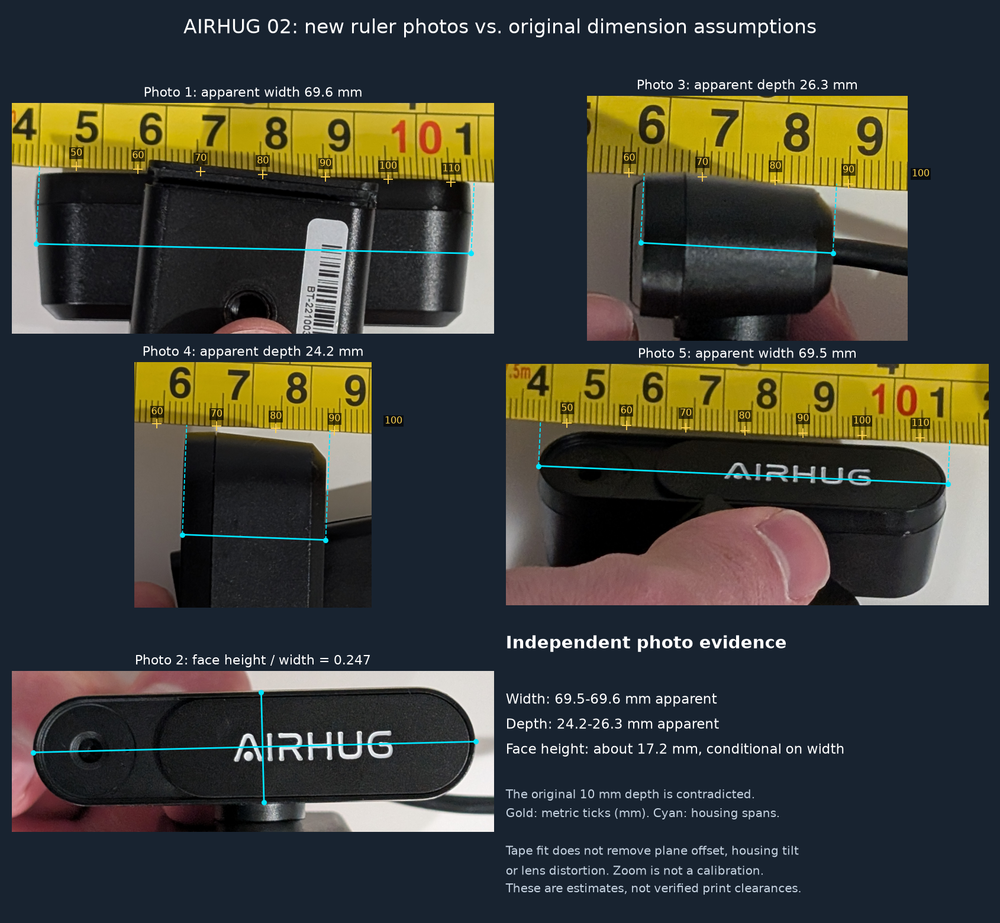
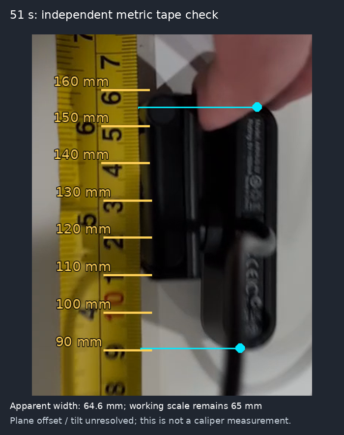
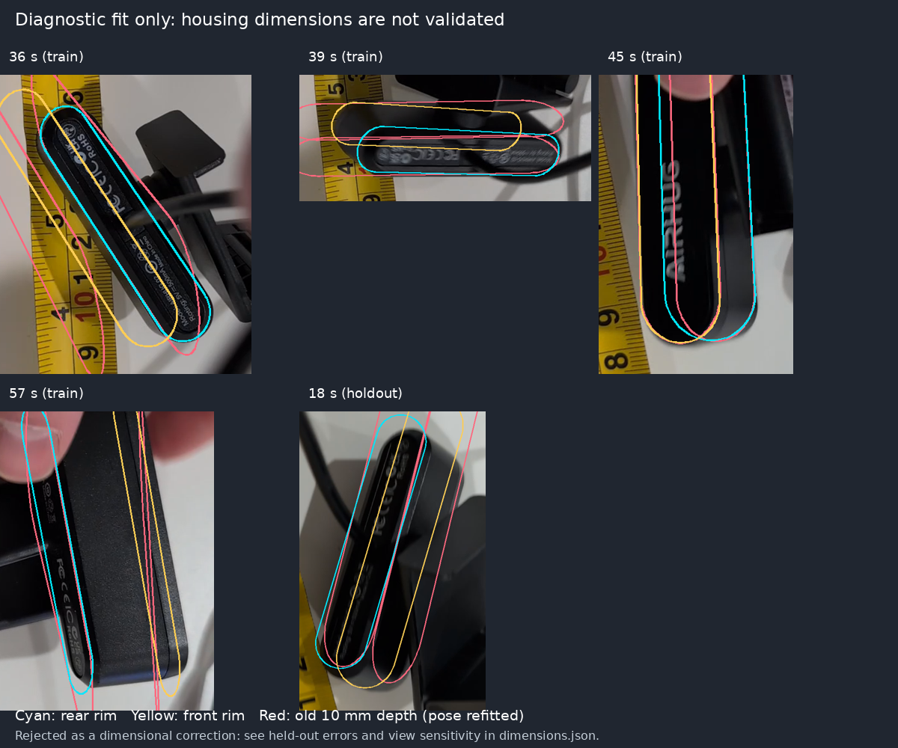

# Webcam dimension audit after the fit-check feedback

**The original mount's camera fit is unverified. Do not use the existing complete
mount 3MF as a dimensionally corrected print.** The old 65 × 16.1 × 10 mm housing
is a hypothesis, not a measurement. The fit-check pieces already printed remain
useful as records of their actual openings; a successful screw fit says nothing
about the camera envelope.

The original analysis fixed width at 65 mm, adjusted height against two face
outlines, and never optimized depth or the clip. Its 2.10 pixel training error
could not establish that the three-dimensional camera would fit. In particular,
subtracting the original model from its own clamp only established internal CAD
consistency. It did not validate the real hardware.

## New ruler photos: the depth error is now clear

The [five follow-up photographs](https://github.com/sgbaird/balloon-pop-game/pull/14#issuecomment-6549291320)
provide independent evidence after the video audit below. You described taking
these farther away with your phone zoomed in. This is useful for reducing
relative perspective differences, but zoom alone does not establish intrinsics
or put the tape and housing in the same plane.



| Check | New photo result | Consequence |
| --- | --- | --- |
| Width, photos 1 and 5 | **69.6 and 69.5 mm apparent span** | Use roughly **70 mm** as the next nominal width, replacing the old 65 mm scale assumption. The original 65.6 mm gauge is likely too narrow. |
| Body depth, photos 3 and 4 | **26.3 and 24.2 mm apparent span** | The old 10 mm depth is contradicted. A working depth near **25 mm** is supported; the original 10.6 mm gauge cannot check this body. |
| Face height, photo 2 | Height/width ratio **0.2475**, or **17.2 mm** using the new width | A nominal height around **17–18 mm** is plausible. This transfers scale from other views; it is not a direct ruler measurement of height. |
| Lens and privacy cover | Lens visible at the left; lettered panel shifted to the right | The original centered, closed-cover representation is incomplete. The moving cover and left optical face must stay clear of any cradle. |

These are **apparent photo measurements**, not verified manufacturing dimensions.
They support a working envelope near **70 × 17–18 × 25 mm** (width × face
height × body depth). The side-view difference of **2.1 mm** is larger than the
roughly 0.4 mm endpoint-selection sensitivity; pose, plane offset, different
visible surfaces and manual selection still matter. Do not average away that
disagreement and claim a submillimetre depth tolerance.

`audit_photos.py` fits each photo's metric centimetre ticks independently to a
one-dimensional projective ruler, then projects the housing endpoints onto its
image axis. The annotations refer to actual tick marks, not the centres of the
large printed numbers. Depth spans include the rigid front bezel and rear shell,
excluding the thin projecting cover, cable and clip. Photo 2 uses perpendicular
face height and the long-axis span; it does not borrow the ruler scale from a
different photo's pixels. Source URLs, SHA-256 hashes, annotation coordinates and
feature definitions are in [photo-landmarks.json](evidence/photo-landmarks.json).
The source photos stay outside the repository; the figure is a cropped analysis
plot of all five attachments.

The [photo report](evidence/photo-audit.json) records per-photo ruler coefficients,
tick residuals, leave-one-tick-out predictions, comparison with a straight affine
ruler, endpoint sensitivity and explicit ±5% scale scenarios. The affine and
projective span estimates differ by less than 0.05 mm here. That is a consistency
check on interpolation, **not** evidence of 0.05 mm camera accuracy. Likewise,
close agreement between the two width photos can share systematic error. The
±5% scenarios illustrate scale dependence; they are not measured confidence
bounds, and they do not cover every possible pose or plane error.

**The old STL/3MF files remain the old prototype, not a corrected mount.** This
follow-up changes the evidence and fit guidance, not the CAD or sliced projects.
The photos give a much better nominal housing envelope, but do not establish the
folded clip/hinge envelope, saddle contact surfaces or cover travel needed to
validate a replacement clamp. Regenerating only the camera-depth parameter would
also leave the existing saddle walls and keeper positions to be checked. Keep
the already printed screw; do not force either old housing gauge onto the camera.

Reproduce this photo analysis independently of the video:

```bash
python -m pip install numpy scipy pillow matplotlib
# Downloads and verifies the five exact attachments; originals stay outside repo.
python cad/airhug02/audit_photos.py /tmp/airhug-photos --download
# Or omit --download to use previously downloaded 1.png through 5.png.
```

Photo follow-up checks: regenerated the report and plot from all five verified
attachments, visually inspected all five overlays, and passed five numerical
tests (including synthetic projective and vertical ruler recovery), Python
compilation and `git diff --check`. No CAD regeneration, slicing, physical fit,
clamping/load test, game run or camera/projector calibration was performed.

## Earlier video audit (superseded where the new photos constrain size)

The following records the earlier audit and why its fitted height/depth were
rejected. Its 65 mm scale prior is no longer the preferred nominal width. It
was not rerun or combined with the new photos as if they shared camera intrinsics.

## What was re-examined

The entire 61-second source was sampled for view selection, with detailed
inspection of the camera, clip and tape views. The scripts verify the original
video's SHA-256 and its autorotated **1080 × 1920** frame size before analysis.
[Video metadata](evidence/video-metadata.json) identifies a **Pixel 9**, but does
not supply lens selection, zoom, stabilization crop or focal length. Knowing the
phone model does not establish its recording intrinsics.

Two separate checks now replace the face-only argument:

1. **Metric tape audit at 51 seconds.** Eight annotated centimetre ticks fit a
   one-dimensional projective ruler. The approximately parallel housing axis
   projects to an apparent **64.6 mm width**. This supports keeping 65 mm as a
   working scale. It does not prove it: the upper cap touches the hand, and the
   housing and tape are at different depths. The small ruler interpolation
   error measures tick consistency, not webcam accuracy. Explicit ±10% scale
   scenarios give 58.2–71.1 mm; these are assumptions, not confidence bounds.
2. **Joint three-dimensional diagnostic at 36, 39, 45 and 57 seconds.** Both
   visible housing rims constrain a shared capsule height and depth, with a
   separate perspective pose per view. Missing/occluded edges are omitted.
   SIFT matches on the rear lettering, with affine stretching for the oblique
   view and RANSAC rejection, constrain relative face poses. Continuous
   point-to-segment distances replace the old nearest-sampled-vertex loss.
   Pose initialization tries 21 tilt combinations per view and both normal
   choices. Focal lengths 900, 1,400 and 2,200 px are tested, with square pixels,
   centered principal point and zero distortion still assumed.



## Why the new fit is not a replacement set of dimensions

The extra constraints expose how sensitive the inferred depth is to pose,
partial boundaries and the assumed capsule shape. A candidate that improves
some training contours is insufficient. The **18-second view is excluded from
shape fitting**; only its pose is fitted using the frozen candidate dimensions.
The original dimensions receive the same pose-fitting opportunity. The report
also removes each training view in turn and refits locally to reveal dependence
on a particular view. These are diagnostics, not statistical confidence bounds.

For this run, the focal sweep produced candidate heights of **12.5–13.8 mm**
and depths of **19.1–20.4 mm**, at the assumed 65 mm width.
The 1,400 px candidate's held-out outline RMS was **17.9 pixels**,
versus **30.2 pixels** for the old dimensions. That is an improvement,
but still an imperfect match. Removing the 57-second view changes inferred
depth to **24.3 mm**. The 2 mm sensitivity flag in the report is
a review threshold, not a claimed manufacturing tolerance. These results do
not justify replacing the 10 mm guess with a precise 20 mm claim.

[The numerical report](evidence/dimensions.json) records the focal sweep,
per-view errors, old-model comparison, held-out error, view-removal sensitivity
and explicit rejection reasons. **No new height/depth pair has been accepted
for CAD.** The comparison below deliberately includes imperfect overlays so a
plausible-looking projection cannot stand in for validation. Complete outlines
through fingers, cables and the clip are extrapolations, not observations.



| Dimension | Current conclusion | Effect on the existing print |
| --- | --- | --- |
| Housing width | Near 65 mm remains plausible from the tape; plane offset unresolved | 65.6 mm width gauge is still a useful physical check |
| Housing height | Old 16.1 mm value was conditional on pose and width | Existing coupons do not check height |
| Housing depth | Old 10 mm was never fitted; new candidates fail sufficient independent validation | 10.6 mm gauge only tests that particular opening; do not force it |
| Clip, hinge and folded envelope | Still approximate; not reconstructed by the rim fitter | Clip clearance and keeper placement are unverified |
| Ledge and clamp grip | Not determined by this housing analysis | Requires physical contact/grip checks |

The published STL/3MF files, camera render and assembly GIF retain the original
prototype dimensions. They were **not regenerated with an unvalidated candidate**.
The [manufacturer's page](https://airhug.com/products/airhug-02-mini-webcam-without-microphone)
labels its dimensions as *package dimensions*, so those are not used as housing
measurements either.

## Remaining checks before correcting the printable mount

The new photos supply approximate housing dimensions. Confirm the contact
dimensions and cover protrusion directly, plus the folded clip's width/depth/height
and hinge position, before treating a replacement mount as a verified fit. Keep
the cable and cover travel clear.

For useful follow-up photos, put a metric ruler **alongside the measured face in
the same plane**, show both ends, keep fingers off the outline, and take separate
front and edge views. A short orbit with a stationary camera body and a rigid
printed calibration target would additionally constrain the filming camera's
intrinsics; do not use the AIRHUG's own advertised FOV for that purpose.

Once measured, update `camera_w`, `camera_h` and `camera_d` in `mount.scad`, inspect
the clip clearance and keeper locations, then regenerate and validate the meshes
and both slices. The existing `validate.py` checks the CAD and printer artifacts;
it cannot certify that a camera-sized void matches a real camera.

## Reproduce the audit

```bash
python -m pip install numpy scipy pillow opencv-python-headless
python cad/airhug02/match_rear.py /path/to/video.mp4
python cad/airhug02/audit_ruler.py /path/to/video.mp4
python cad/airhug02/fit_dimensions.py /path/to/video.mp4
python -m unittest discover -s cad/airhug02 -p test_dimensions.py -v
python -m py_compile *.py cad/airhug02/*.py
```

Manual rim selections are in [dimension-landmarks.json](evidence/dimension-landmarks.json),
tape selections in [ruler-landmarks.json](evidence/ruler-landmarks.json), and
feature correspondences in [rear-matches.json](evidence/rear-matches.json).
Synthetic checks verify continuous segment distances, joint shape recovery from
known perspective views and preservation of fixed dimensions during pose fitting.
They test the mathematics, not this webcam's true size. Image overlays and
ruler reports were regenerated from the original video. No new slicing, physical
fit, clamping/load test, game run or camera/projector calibration was performed.
