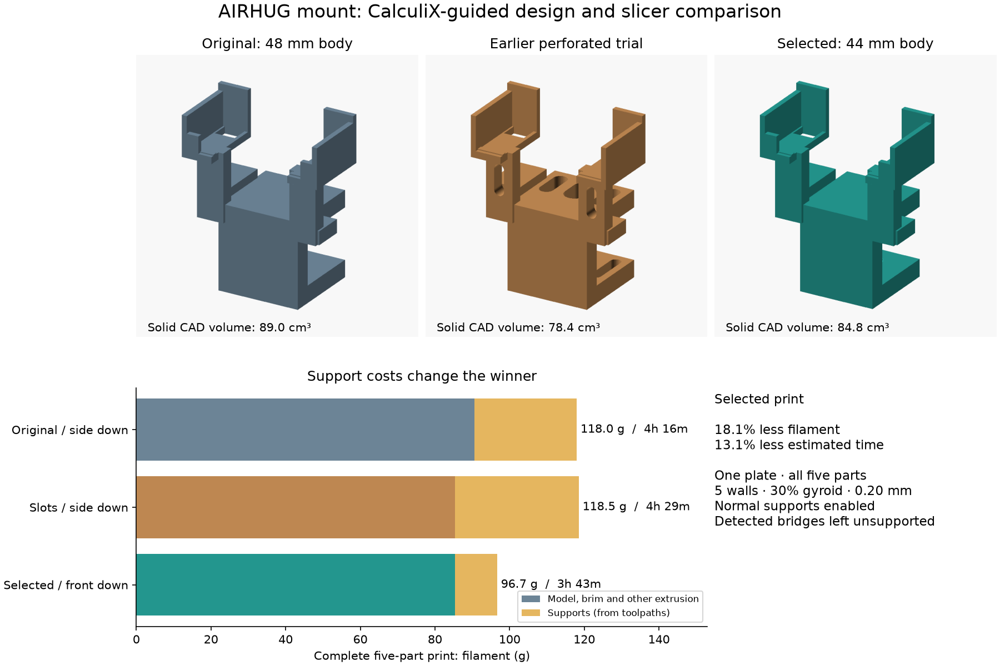

# Curved-frame revision: topology lessons plus side retention

The [current sliced 3MF](slicer/mount/mount-a1mini-pla.3mf) combines the **10 mm
side lips and 62 mm central opening** with curved jaw footprints, rounded windows
in the spine and both camera uprights, and closed side frames around the saddles.
It is **93.13 g / 3 h 46 min**, including supports, brims, screw, pad and two keepers,
on one A1 mini plate. The unchanged print profile uses a 0.4 mm nozzle, PLA,
0.20 mm layers, five walls, 30% gyroid and normal supports with detected bridges
left unsupported.


| Complete five-part print | Filament including supports | Estimated time |
| --- | ---: | ---: |
| Original side-lip / 48 mm / side down | 118.00 g | 4 h 16 min |
| Previous selected solid / 44 mm / front down | 96.68 g | 3 h 43 min |
| **Current curved frame / 44 mm / front down** | **93.13 g** | **3 h 46 min** |

The new shape saves **3.7% filament** against the immediately preceding file but
adds **207 seconds (1.6%)** of estimated print time. Against the original side-lip
plate it saves **21.1% filament and 11.8% time**. Support extrusion is about
**13.1 g** versus the previous solid frame's **11.3 g**; the model saving still
wins on total filament. These are slicer estimates, not measured print results.
The extra side-wall perimeters and supports are an explicit tradeoff for the
more open geometry. The previous numerical study below remains historical.

## Geometry and structural screening

This is a **parametric shape refinement informed by the earlier topology search**,
not a new global density optimizer or an unconstrained organic topology optimum.
The earlier search showed that the spine roots carry the clamp preload and that
holes can increase support costs. This revision keeps those roots, moves more
material to the spine, and removes jaw corners and smaller interior regions:

- Taper the 44 mm wide jaws to **28 mm diameter rounded ends**, leaving at least
  **5.75 mm radial material** around the maximum modeled female thread radius.
  Both jaws retain their 10 mm thickness and flat bearing faces.
- Increase spine depth from 10 to **12 mm**, toward the rear of the clamp rather
  than into the 30 mm ledge opening. A **10 × 14 mm rounded opening** leaves two
  17 mm wide side ribs and 18 mm of material to each outside jaw surface.
- Add **6 × 16 mm rounded upright windows**, retaining 5 mm side ribs.
- Open **7 × 23 mm side-wall windows** within the 3 mm thick end walls. A closed
  perimeter remains, with 6.5 mm above/below each window. The floors, keeper
  guides, lip dimensions, locating stop and moving parts retain their dimensions.

An initial aggressive **16 × 25.3 mm spine opening in a 10 mm spine** failed:
**10.11 MPa** peak combined stress at 1 mm. It was rejected. Reducing the opening
and thickening the spine brought the final shape below the same **8 MPa assumed
screening limit** without reverting to the rectangular jaw ends.

The final exported STL was solved with the existing CalculiX C3D8 procedure,
upper-jaw restraint, E = 1,200 MPa, ν = 0.35, 100 N clamp preload and two 5 N
camera/cable load cases plus preload superpositions. Load totals remain the same;
the tapered jaw's contact area and distributed load node counts follow its actual
geometry. See the historical assumptions below for the limitations of this
bonded-contact, isotropic model.

| Final voxel pitch | Elements | Peak combined stress | Preload displacement | Camera-only displacement |
| --- | ---: | ---: | ---: | ---: |
| 1.5 mm | 22,769 | 6.01 MPa | 1.52 mm | 0.112 mm |
| 1.0 mm | 76,411 | **6.60 MPa** | **1.45 mm** | **0.141 mm** |

Energy/work relative errors are below 1 × 10⁻⁸; no disconnected voxels were
discarded. These two pitches provide mesh sensitivity, not proof of convergence
or a validated safety factor. Compared with the prior solid frame's 6.88 MPa,
1.67 mm preload displacement and 0.121 mm camera-only displacement at 1 mm, the
new frame has lower simulated preload deformation but somewhat higher camera-only
movement. Its exact solid volume is recorded in [the new report](optimization/sculpted.json).

## Retention and print checks

The independent 27-housing sweep still clears the seated body and keeper
adjustment. Forward crossings remain blocked by the side lips until **6.0–9.7 mm
of straight lift**. New checks translate each housing **8 mm left and right**:
all 54 lateral crossing poses intersect the retained side frames. This checks
centred, unrotated translations, not every combined or rotated escape path.
The open top still permits lift-out. The camera/cover illustration and clip
keepout, screw rotation/travel and seated pad pass the existing interference
checks. Print meshes are watertight; the clamp is one connected solid. All five
parts fit one plate, and Bambu Studio reports no geometry warnings.

**Not tested:** physical printing, supports/bridge quality, camera or ledge fit,
real cover motion or camera view, friction, holding force, impacts, layer strength,
fatigue, PLA creep or the game. The simulation does not establish a tested load
rating or physical retention performance.

## Reproduce the current revision

[sculpted.json](optimization/sculpted.json) stores final and rejected solver
results, complete-plate slicing metrics and artifact hashes. The new compressed
[decks and solver logs](optimization/decks) use the `sculpted-` prefix. The earlier
`run.json`, `structural.json`, `slicing.json` and optimization image describe the
historical study below and are preserved as evidence.

```bash
python cad/airhug02/build.py /tmp/squashfs-root/AppRun
python cad/airhug02/structural_fem.py cad/airhug02/stl/clamp.stl /tmp/sculpted-fe --pitch 1.0
python cad/airhug02/validate.py
python cad/airhug02/check_retention.py
python cad/airhug02/preview_sculpted.py
python cad/airhug02/preview_toolpaths.py
python -m unittest discover -s cad/airhug02 -p 'test_*.py'
python -m py_compile *.py cad/airhug02/*.py
```

For the previous solid CAD, set `-D 'sculpted=false'`. Add that override to the
historical OpenSCAD commands below to reproduce their original geometry. Use
the committed STL for the analyzed final shape; reslice any modified geometry.

---

# Earlier CalculiX and print-cost study

The supplied [single-plate 3MF](slicer/mount/mount-a1mini-pla.3mf) uses a **44 mm
solid clamp body**, front down, with normal removable supports and support omitted
under detected bridges. This reduces the complete print from **118.0 g / 4 h
16 min to 96.7 g / 3 h 43 min**: **18.1% less filament and 13.1% less estimated
time**, including supports, brims and the same five parts. Estimates are from
Bambu Studio, not measured print times. No physical print or load test was run.



The topology search used the corrected, photo-informed revision at `005a54c`,
not the earlier undersized mount. During this study, another session added
10 mm side lips in `bd7ed72`. Those retention changes are preserved and the
final simulations were rerun on the combined geometry. The main print-cost
comparison above uses that newer **side-lip baseline**; the earlier topology
trials retain their original geometry and estimates in the table below. Camera supports, 76 mm clear saddle width, keeper
travel, 30 mm ledge opening, 38 mm throat, 10 mm jaw thickness, screw and locating
stops are preserved. Only the central jaw/spine body width changes from 48 to
44 mm. Its solid CAD volume falls from 88.98 to 84.78 cm³ (**4.7%**); this is not
the sliced volume because the print contains infill. The lower jaw retains about
13.75 mm from the thread's maximum modeled radius to each side edge.

## Material removal versus manufacturability

[optimize.py](optimize.py) performs **discrete topology optimization**, inserting
rounded slots into a fixed design domain. This is a restricted hole-insertion
search, not a global SIMP optimum. CalculiX internal energy density ranks the
potential removals by normalized load-case sensitivity per removed volume.
Every proposal is Boolean-cut, checked for a single watertight solid, remeshed,
and re-solved. Threads, saddles and moving-part clearances are kept outside the
slot domains. No solver package is implied to contain a built-in topology optimizer.

Nine slot proposals produced seven accepted holes at the coarse screening level;
the two spine holes failed the 8 MPa screening stress constraint. Acceptance also
required peak displacement below 1.2 mm for preload/combined cases and 0.5 mm for
camera-only cases in the initial spine-restraint model. The accepted geometry
removed **11.4% of solid CAD volume**, but normal supports filled extra overhangs
and the holes required extra walls. It used **118.5 g / 4 h 29 min**, worse than
the starting plate. Two accepted channels aligned with the side-down print axis
also failed to improve the complete print: **115.1 g / 4 h 31 min**, with bridge
support omitted. The spine channel failed the structural screen.

A subsequent shape comparison narrowed the solid central body to 36 or 40 mm.
The 36 mm body sliced at 91.2 g / 3 h 33 min, but its 1.5 mm mesh had about
2.49 mm preload deflection versus 2.21 mm for the 40 mm body, and less stress
margin. The 40 mm body then reached **8.10 MPa** under combined loads at 1 mm,
exceeding the assumed 8 MPa screen; it was rejected despite its attractive
93.1 g / 3 h 36 min slice. The final body is 44 mm wide.
The original slot-search displacement constraint belongs to its spine-restraint
model; it is not transferred to the different upper-jaw-restraint model.

Selected comparisons (all five parts, 0.4 mm nozzle, PLA, 0.20 mm layers, five
walls, 30% gyroid, five top/bottom layers, 5 mm brims):

| Body / orientation / support | Plates | Total filament | Support extrusion¹ | Estimated total |
| --- | ---: | ---: | ---: | ---: |
| Original 48 mm / side / normal | 1 | 117.5 g | 27.4 g | 4 h 15 min |
| Side-lip baseline 48 mm / side / normal | 1 | 118.0 g | 27.4 g | 4 h 16 min |
| Seven holes / side / normal | 1 | 118.5 g | 33.1 g | 4 h 29 min |
| Original 48 mm / side / tree | 2 | 102.5 g | 12.2 g | 4 h 24 min |
| Original 48 mm / front / normal | 1 | 105.6 g | 18.5 g | 3 h 56 min |
| Original 48 mm / front / normal, bridges omitted | 1 | 98.5 g | 11.4 g | 3 h 45 min |
| Seven holes / front / normal, bridges omitted | 1 | 101.3 g | 16.8 g | 4 h 05 min |
| Narrow 36 mm / front / normal, bridges omitted | 1 | 91.2 g | 11.8 g | 3 h 33 min |
| Narrow 40 mm / front / normal, bridges omitted | 1 | 93.1 g | 10.9 g | 3 h 36 min |
| **Selected 44 mm / front / normal, bridges omitted** | **1** | **96.7 g** | **11.3 g** | **3 h 43 min** |

¹ Support masses are reconstructed from positive moving extrusion in actual
G-code, including support transitions/interfaces, using 1.75 mm filament and
1.24 g/cm³. Retraction recovery, purging and other extrusion mean this is an
attribution estimate, not an independently weighed mass. Total masses/times come
from the slicer's reports. The [complete comparisons](optimization/slicing.json)
include 18 configurations. Tree support's automatic layouts required two plates;
we did not select them for the requested one-shot job. Support removal time was
not measured or assigned a fictitious numerical saving. Fewer supports should
reduce cleanup, but bridging can leave rougher surfaces.

Most of the overall saving comes from orientation/support strategy: the original
body without the later lips, with those settings, already reaches 98.5 g.
The selected narrower body with the later lips reaches 96.7 g. The overall
saving is therefore chiefly a support/orientation result; the 4 mm body-width
reduction contributes a smaller additional saving. The final model therefore follows the better
measured print-cost result rather than the most perforated appearance.

## Structural assumptions and limits

[structural_fem.py](structural_fem.py) uses actual exported clamp geometry sampled
at voxel centers, with fully integrated **C3D8** elements in **CalculiX 2.21**.
Units are N, mm and MPa. A nonintegral grid offset avoids ambiguous point tests on
integer CAD faces. Face connectivity is checked; no isolated voxels were removed
in the recorded cases. Each element has eight stress/energy integration points.
For every base load case, external force/displacement work is checked against
twice the integrated strain energy. Committed decks and logs permit independent
reruns; the large raw DAT files are regenerated instead of committed.

Assumed isotropic linear elastic **E = 1,200 MPa, ν = 0.35** represents a screening
homogenization, not a measured filament or infill property. **8 MPa** is an assumed
screening limit, not a certified printed-material allowable. Neither gives a
validated safety factor. Layer adhesion, shell/infill geometry, defects,
orthotropy, temperature and time-dependent PLA creep are not modeled. At half
this stiffness, linear-model displacements double while force-controlled
stresses stay unchanged. The front-down orientation places different stress
components across layers than the original side-down print, making real print
quality and layer strength especially relevant.

Three independent static load cases are solved:

- **Preload:** 100 N downward distributed around the lower jaw/thread region,
  balanced by 100 N upward over an upper-jaw contact patch. This opens the C
  frame. It is an assumed light clamping scenario, not a screw-torque calibration.
- **Camera and forward cable:** 5 N downward plus 5 N forward at the saddle floors.
- **Camera and sideways cable:** 5 N downward plus 5 N sideways at those floors.

Stress tensors and displacement vectors are also superposed for preload plus
both camera cases. Gravity/cable forces therefore are not assessed only in
isolation. Screw, pad, wedge friction and local thread-to-thread contact are not
explicitly meshed: the frame receives distributed equivalent loads. The reused
screw has not acquired a demonstrated load rating from this analysis.

Two idealized restraints explore a significant modeling uncertainty:

- The **initial spine model** fixes a 16 mm wide patch near the ledge edge in all
  three directions. It is useful for relative slot ranking. Its fixed-patch edge
  generates a mesh-sensitive local peak: the original rises from about 7.5 MPa at
  2 mm to 9.7 MPa at 1 mm; the perforated trial is about 10.1 MPa with combined
  loads at 1 mm. The coarse 8 MPa acceptance is consequently **not a fine-mesh
  strength approval**. The peak lies near X = −7.8, Y = 0.2, Z = 30.2 mm, at the
  artificial restraint edge. We retain those results rather than reporting a
  favorable coarse value as converged.
- The **upper-jaw model** bonds a distributed contact patch to a rigid ledge,
  assuming no slip. It lets the spine/lower jaw flex and is used for the solid
  width comparison. It also remains an idealization: actual contact can lift or
  slide, and the real ledge's finish/compliance is unknown. Results under this
  restraint do not validate the friction assumption.

## Reproduce and inspect

The [structural records](optimization/structural.json) contain element counts,
mesh pitches, displacements, peak and 99th-percentile stresses, integrated
energies and input SHA-256 hashes. The [slot-search history](optimization/perforated-study.json)
and [channel-search history](optimization/channel-study.json) preserve accepted
and rejected proposals. The [input decks](optimization/decks) are gzip-compressed
CalculiX inputs with solver logs; decompress into a temporary directory and run
`ccx model` after naming the input `model.inp`.

Reference software: [CalculiX](https://www.dhondt.de/) 2.21, OpenSCAD 2021.01,
and [Bambu Studio 02.08.02.61](https://github.com/bambulab/BambuStudio/releases/tag/v02.08.02.61).
The solver's official documentation describes C3D8, `*EL PRINT` and `ENER`; the
scripts use the eight integration-point values rather than a smoothed display
stress. No AI-generated geometry or image is used in the analysis figures.

```bash
# System packages: calculix-ccx openscad xvfb plus the Bambu AppImage libraries.
python -m pip install numpy scipy trimesh manifold3d embreex matplotlib pillow shapely mapbox-earcut
# Run the hole-insertion search on the fixed original 48 mm / side-down design:
python cad/airhug02/optimize.py /tmp/slot-study --coarse-only
python cad/airhug02/optimize.py /tmp/channel-study --channels --coarse-only
# Omit --coarse-only to also solve at 1.5 and 1.0 mm.
# For a body-width comparison, export in the documented original orientation:
openscad -o /tmp/body40.stl -D 'part="clamp"' -D 'clamp_w=40' -D 'side_lip_height=0' -D 'print_orientation="side"' cad/airhug02/mount.scad
python cad/airhug02/structural_fem.py /tmp/body40.stl /tmp/body40-fe --orientation side --pitch 1.0
# Export, slice and validate the selected default (44 mm, front down):
python cad/airhug02/build.py /tmp/squashfs-root/AppRun
python cad/airhug02/structural_fem.py cad/airhug02/stl/clamp.stl /tmp/selected-fe --pitch 1.0
python cad/airhug02/validate.py
# Compare supplied print-oriented meshes with support costs included:
python cad/airhug02/slice_study.py /tmp/squashfs-root/AppRun /tmp/slice-study cad/airhug02/stl/clamp.stl --supports normal --bridge
python cad/airhug02/plot_optimization.py
python cad/airhug02/preview_toolpaths.py
python -m unittest discover -s cad/airhug02 -p 'test_*.py'
python -m py_compile *.py cad/airhug02/*.py
```

Geometry checks cover watertightness, a single clamp solid, printer bounds, all
five parts on one plate, 27 housing/keeper scenarios, clip clearance, screw
advance/rotation and seated-pad clearance. The exported sliced 3MF contains
matching A1 mini/PLA settings and G-code without geometry warnings. Toolpath
previews show model/support extrusion and the first layer. Headless thumbnail
rendering reports a display initialization error; slicing itself succeeds and
the separate preview uses the generated G-code.

**Not tested:** an actual print, support removal, bridge sag, fit to the physical
camera/ledge, threaded joint strength, friction/holding force, material strength,
fatigue, impacts, PLA creep or calibration/game operation. Slicer success and the
linear elastic screening do not establish these properties. Tighten lightly by
hand, keep cable slack, and check for rocking or slip with the actual camera
before leaving it installed. The force scenarios are not a certified load rating.

## Final structural screen

For the selected **44 mm body**, the upper-jaw restraint gives these mesh
sensitivity results. Stresses include the worst of both preload-plus-camera
combinations; camera displacement is the worst of the two camera-only cases.
Preload displacement is the maximum anywhere in the frame, including its lower
jaw, rather than camera drift after the screw has been tightened.

| Voxel pitch | Elements | Peak combined stress | Preload displacement | Camera-only displacement |
| --- | ---: | ---: | ---: | ---: |
| 2.0 mm | 10,749 | 5.48 MPa | 1.64 mm | 0.116 mm |
| 1.5 mm | 24,792 | 6.62 MPa | 2.05 mm | 0.096 mm |
| 1.0 mm | 84,805 | **6.88 MPa** | **1.67 mm** | **0.121 mm** |

The final finest mesh is below the assumed 8 MPa screening limit. In comparison,
the earlier 48 mm baseline without the later lips at 1 mm gives 6.60 MPa peak combined stress, 1.52 mm preload
deflection and 0.113 mm camera-only displacement. The retained 44 mm design is
therefore close to the baseline in this model; the 40 mm candidate's 8.10 MPa
combined peak is why it was not supplied as the final print.

This is **mesh sensitivity, not demonstrated convergence**: voxelized surfaces
and the approximated contact patch change with pitch, and displacement trends
are not monotonic. The 1 mm voxel volumes agree with the exact solid volumes to
within about 0.04%, but volume agreement alone cannot establish stress accuracy.
The selected cases' energy/work relative residuals are below 2 × 10⁻⁸.
A Boolean comparison after undoing print orientation also confirms that the
supplied STL and the analyzed 44 mm shape differ by less than 0.01 mm³.
