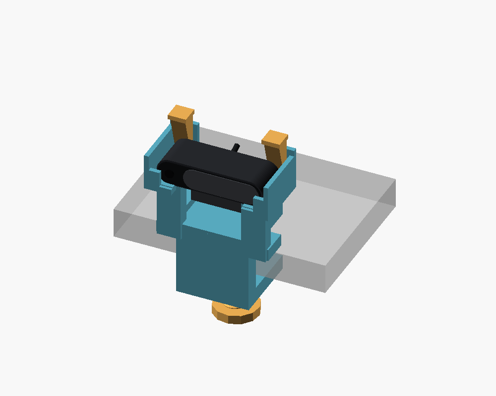
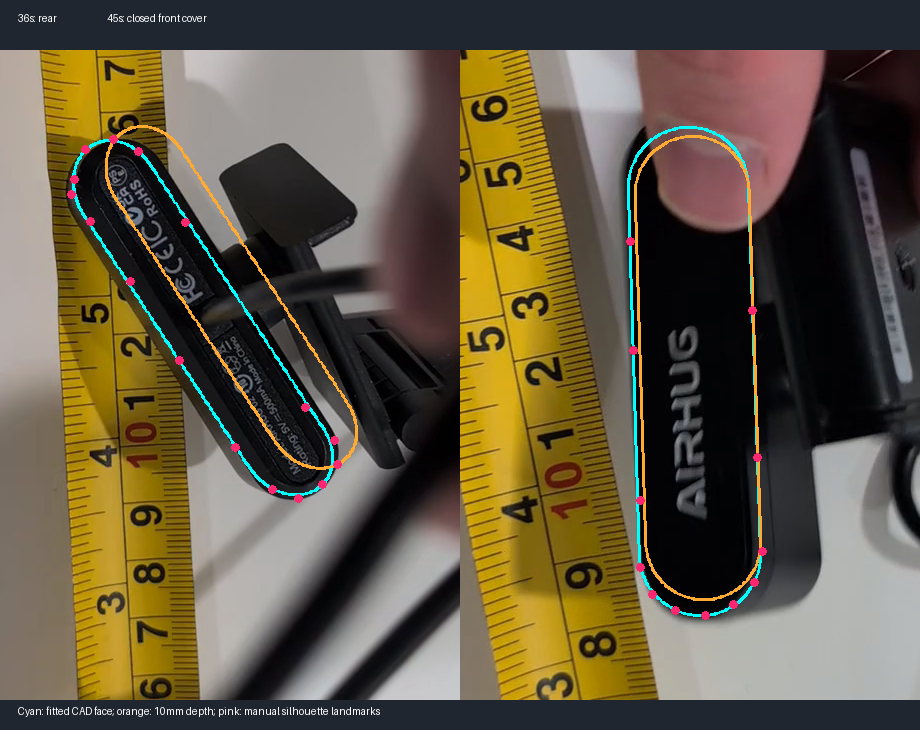
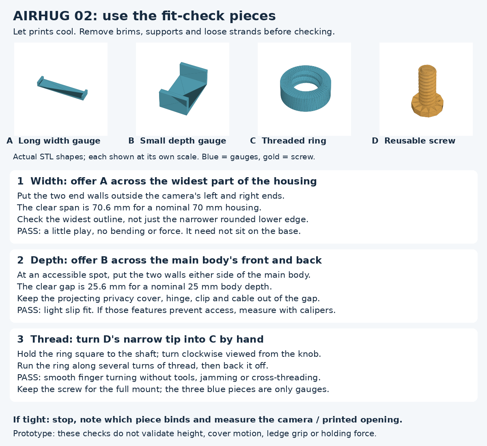
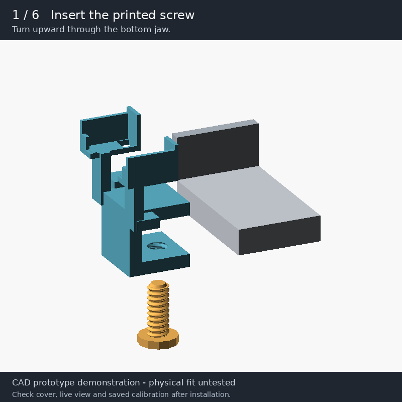
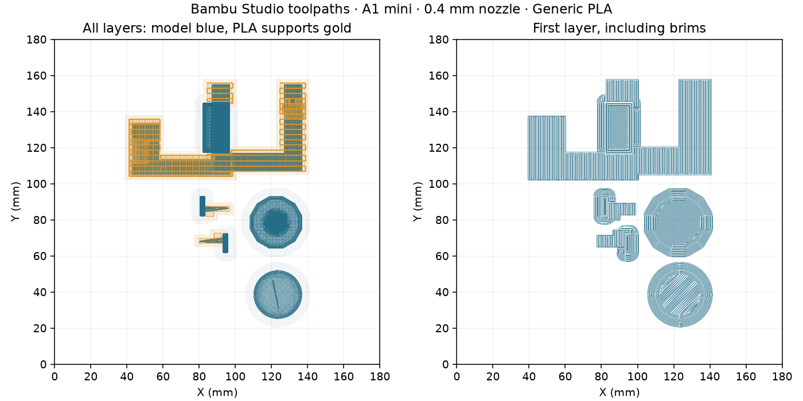

# AIRHUG 02 camera and corner-ledge mount

> **The original housing depth is wrong.** The [new ruler-photo analysis](DIMENSIONS.md#new-ruler-photos-the-depth-error-is-now-clear)
> indicates roughly **70 mm width, 17–18 mm face height and 24–26 mm depth**,
> rather than the original 65 × 16.1 × 10 mm. Existing CAD/STL/3MF files still use
> the original prototype dimensions; they are not a corrected mount. Keep the
> printed screw, but do not force the old width/depth gauges onto the housing.

A video-derived **prototype**, with editable OpenSCAD, exported meshes,
matched-view silhouette comparisons, and **sliced Bambu Studio projects for an
A1 mini, 0.4 mm nozzle, Generic PLA, Textured PEI plate**. No metal hardware is
required: the clamp, screw, loose pressure pad and two keeper wedges are printed.
The real camera and its original clip are retained intact.



For the original prototype, [the fit-check plate](slicer/fit-check/fit-check-a1mini-pla.3mf) checks its assumed openings;
[the complete mount](slicer/mount/mount-a1mini-pla.3mf) remains unverified against the camera.
Bambu estimates about **99 g / 3 h 37 min** for the mount plate and
**18 g / 1 h 2 min** for the fit-check plate, including its reusable screw.
Both contain sliced G-code. Open in Bambu Studio to inspect the plate and confirm
your nozzle, PLA and plate match before printing. The camera STL is a reference
model and is **not** on either print plate.

## Evidence and dimensions

The figures in this section describe the **original hypothesis**. They are
superseded as fit evidence by the [dimension audit](DIMENSIONS.md); the quoted
uncertainties were rough guesses and were not validated tolerances.

Source: [issue video](https://github.com/user-attachments/assets/1d63d449-cc8f-4f6c-bea5-ee4ea75b9208),
61.24 seconds, decoded as 1080 × 1920 after display rotation.
The recording stays outside the repo; `evidence/source.json` records its SHA-256.
The tape beside the housing at 45–54 seconds suggests a width near 65 mm. This
is a manual estimate: tape and housing are at different depths, with partially
hidden ends. The bounds below are approximate, not statistical confidence intervals.

| Feature | Model / interpretation | Uncertainty |
| --- | --- | --- |
| Housing width | 65 mm, fixed scale during fitting | Approximately ±5 mm |
| Capsule height | 16.1 mm, refined from 19 mm | Approximately ±2 mm |
| Main housing depth | 10 mm; cover adds about 1.1 mm | Approximately ±3 mm; not solved by fitting |
| Original clip plates | Roughly 38 × 30–32 × 4 mm | Approximate envelope; hinge details hidden |
| Ledge lip | Approximately 15–25 mm from early tape views | Perspective and depth mismatch limit precision |
| Clamp opening / reach | 30 mm / 38 mm | CAD dimensions |
| Intended ledge thickness | 10–25 mm with supplied pad | Requires clear underside and flat contact |
| Housing clearance | 0.6 mm total, plus rear wedge space | Print coupons first |
| Corner stop | Left jamb; camera centre 40 mm from contact | Assumes a square inside corner |

The external model follows the visible capsule, covered face, lettering, folding
clip and short cable exit. Lens internals, regulatory lettering, exact hinge
geometry and hidden surfaces are not reproduced precisely. The lens was not
visible clearly enough in the original video; the new photos show it on the left
with the lettered cover shifted right. That detail is not yet in the old model.
This is an exterior fit model, not a manufacturer-exact replica.

## Rotations and intrinsics

This is the historical face-only fit, retained for traceability. Its training
error does not validate the depth or absolute dimensions.



`fit_video.py` fits a projected capsule to **28 manually selected visible contour
points** at 36 and 45 seconds. Housing height is shared; each frame gets its own
rigid pose. Width stays fixed at the tape-derived 65 mm. Occluded boundaries are
excluded. The overlay compares the CAD housing face; orange illustrates the
assumed depth, which is not optimized. The full clip is not fitted.

At an assumed focal length of 1,400 pixels, changing the initial 19 mm height to
16.1 mm reduced contour RMS error from **2.80 to 2.10 pixels**, after refitting
poses in both cases. This is an in-sample fit to hand annotations, not independent
physical validation. See [fit results](evidence/fit.json) and
[landmarks](evidence/landmarks.json).

The **recording phone's intrinsics cannot be reliably recovered** from these
partially occluded, mostly planar views. Square pixels, zero distortion and a
centred principal point are assumptions. The working matrix is:

```text
K = [[1400,    0, 540],
     [   0, 1400, 960],
     [   0,    0,   1]]
```

This corresponds to approximately 42° horizontal and 69° vertical field of view.
Fitted optical-axis distances at this prior are about 222 mm and 187 mm. Sweeping
focal length from 900 to 2,200 pixels yields similar errors (1.89–2.10 pixels)
and heights (16.01–16.11 mm), while distances range from 120 to 348 mm.
**1,400 pixels is a working prior, not a measured focal length.**
Do not use this matrix in the game: it describes assumptions about the phone
filming the webcam. The AIRHUG's own intrinsics require images captured *by* it
of a calibration target. Its [listed 78° FOV](https://airhug.com/products/airhug-02-mini-webcam-without-microphone)
does not establish the filming phone's intrinsics or the mount dimensions.

## Using the fit-check pieces



There are **four loose pieces** after removing supports and brims: three gauges
from `coupon.stl` and one full screw. They are separate checks, not a little
clamp to assemble onto the ledge. Let them cool and clear loose strands and
support material from the openings first.

| Piece | How to use it | What a pass looks like |
| --- | --- | --- |
| **A — long, shallow U-shaped width gauge** | Offer the **65.6 mm clear span** across the main housing's left and right ends. Align the end walls with its widest outline; checking only the narrower rounded lower edge can give a false pass. The housing need not bottom against the gauge's base. | Nominal 65 mm body fits between the walls with slight play, without spreading them. |
| **B — small, taller U-shaped depth gauge** | Offer the **10.6 mm gap** across the main body's front-to-back thickness at an accessible spot. Keep the projecting privacy cover, hinge, original clip and cable outside the gap. If there is no accessible spot, use calipers on the body instead. | Nominal 10 mm main body slips between the walls without force. |
| **C + D — short threaded ring and screw** | Hold the ring square to the shaft. Start the screw's narrow tip in it and turn clockwise **as viewed from the knob toward the tip**. Move the ring along several turns of thread and back off. | Smooth turning with fingers; no tools, cross-threading or jamming. The ring is 8 mm tall, only about two thread pitches, so this is a running-fit check, not a load test. |

The width and depth openings each have **0.6 mm total nominal clearance**, not
0.6 mm per side. The new ruler photos show the depth gauge is undersized and
suggest the width gauge is too narrow as well; their openings describe the old
hypothesis, not the actual camera. These gauges do **not** check the housing
height, cover motion, folded clip clearance, keeper retention, ledge fit or holding
force.
The housing dimensions came from video. Passing these checks still leaves height
and clip clearance unresolved; review the [dimension audit](DIMENSIONS.md) before
printing the full mount.

If something binds, stop and record **which piece**, where it catches, the real
housing width/height/depth, and the printed opening if you have calipers. A photo
of the interference is useful. Remove obvious support debris, but do not force
or sand the gauge wider and then treat it as a dimensional pass. If the ring
binds, check both thread surfaces for debris and print defects; changing camera
`clearance` will not loosen the thread. The female thread's separate radial slack
is the `0.35` argument in `clamp_raw()` and `coupon()` in [mount.scad](mount.scad).
Any thread adjustment must match in both places. Correct the relevant CAD
parameter or print issue, rebuild/reslice, and repeat the affected check before
printing the full mount.

**Keep the screw**: it is the same part used by the full mount. The three gauges
are not installed in the finished assembly. The supplied mount plate includes
another screw; omit that duplicate in Bambu Studio and reslice if reusing this one.

## Printing and assembly



The animation uses the CAD parts and an example 20 mm ledge with a left jamb.
It starts with cleaned printed parts and shows the original camera clip already
folded. Motions illustrate the assembly sequence; they do not validate physical
fit, clamping force or cover clearance. Follow the checks below before use.

1. Print the fit-check plate and follow [Using the fit-check pieces](#using-the-fit-check-pieces)
   above before printing the full mount. If the housing dimensions need changes,
   edit `camera_w`, `camera_h`, `camera_d` or `clearance` in `mount.scad` and
   rebuild both plates; thread fit has its own slack parameter.
2. Print the mount plate: one clamp, one screw, one pad, two keeper wedges.
   The clamp lies on its side. Normal removable supports and 5 mm brims are
   enabled. Supports use PLA; no AMS is needed. Carefully clear support from
   the female thread and cradle. The screw uses a custom 16 mm major diameter,
   4 mm pitch trapezoidal thread; it is not an ISO M16 thread.
3. Insert the screw upward through the bottom jaw. Place the loose pad, socket
   down, on its tip. Slide the clamp fully onto the ledge until its spine meets
   the front lip and its left stop meets the same jamb. The ledge needs at least
   38 mm of clear top and bottom reach. Camera centre is about 53 mm above the
   ledge surface.
4. Tighten lightly by hand, retaining at least two full turns of engagement.
   The pad spreads pressure and is loose when removed. Check the grip before
   installing the camera.
5. Fold the original clip behind the housing, leaving the cable free. Lower the
   housing into the two end saddles. Insert keepers behind each end, thin tip
   first and cap toward the front. Seat gently to take up clearance. These are
   friction wedges; pull caps upward to remove. Check that the cover opens and
   the live image is unobstructed: that motion was not visible in the video.
6. Mark the contact position and cable routing. After reinstalling, seat against
   the same two stops and verify the saved projected-screen corners in the live
   image before assuming the existing calibration still fits.

`corner_side=-1` selects a left jamb, `+1` a right jamb, `0` no stop. Changing it
requires regeneration and slicing. The cradle aims normal to the ledge edge;
there is no pan/tilt joint. If this direction cannot see the projection, a
modified cradle angle is needed. PLA friction, paint, ledge squareness and cable
tension still affect pose. Physical fit, grip, optical clearance, print success
and long-term PLA creep have not been tested. Keep away from projector exhaust.

## Reproduce and inspect

Used here: OpenSCAD 2021.01 and official
[Bambu Studio 02.08.02.61 Ubuntu 24.04 AppImage](https://github.com/bambulab/BambuStudio/releases/tag/v02.08.02.61),
extracted under `/tmp`. Installation is local to this runner. Scripts do not
download installers automatically.

```bash
# After downloading/extracting the AppImage and installing its system libraries:
python -m pip install numpy scipy pillow opencv-python-headless trimesh manifold3d matplotlib
python cad/airhug02/build.py /tmp/squashfs-root/AppRun
python cad/airhug02/fit_video.py /path/to/video.mp4
python cad/airhug02/validate.py
python cad/airhug02/preview_toolpaths.py
python cad/airhug02/preview_fit_check.py  # instruction sheet from committed STL meshes
python cad/airhug02/animate_assembly.py  # OpenSCAD + Xvfb + Pillow; no slicer needed
python -m py_compile *.py cad/airhug02/*.py
```

`build.py` resolves both `inherits` and `include` in bundled Bambu presets,
preserving the A1 mini's 180 × 180 mm bed and machine start/end G-code. Profile
snapshots are in `slicer/`. Settings: 0.20 mm layers, five walls, 30% gyroid infill,
five top/bottom layers, normal supports. Manufacturer presets supply PLA
temperatures, cooling and motion settings.



`validate.py` checks watertight printable meshes, connected component counts,
180 mm part bounds, zero modeled camera/clamp and screw/thread interference,
and the printer, PLA, supports and start G-code embedded in sliced 3MFs.
[evidence/validation.json](evidence/validation.json) records results and hashes.
`result.json` beside each project preserves slice estimates. GUI thumbnails were
unavailable headlessly; the plot uses actual generated extrusion moves. No game,
camera/projector calibration, physical print or hardware fit was run.

Bambu profile snapshots and embedded profile data derive from Bambu Studio
02.08.02.61, copyright Bambu Lab and contributors, under AGPL-3.0; see
[slicer/BambuStudio-LICENSE.txt](slicer/BambuStudio-LICENSE.txt) and
[matching upstream source](https://github.com/bambulab/BambuStudio/tree/v02.08.02.61/resources/profiles/BBL).
The build script records profile modifications. New CAD and helper scripts use
the repository's license.
