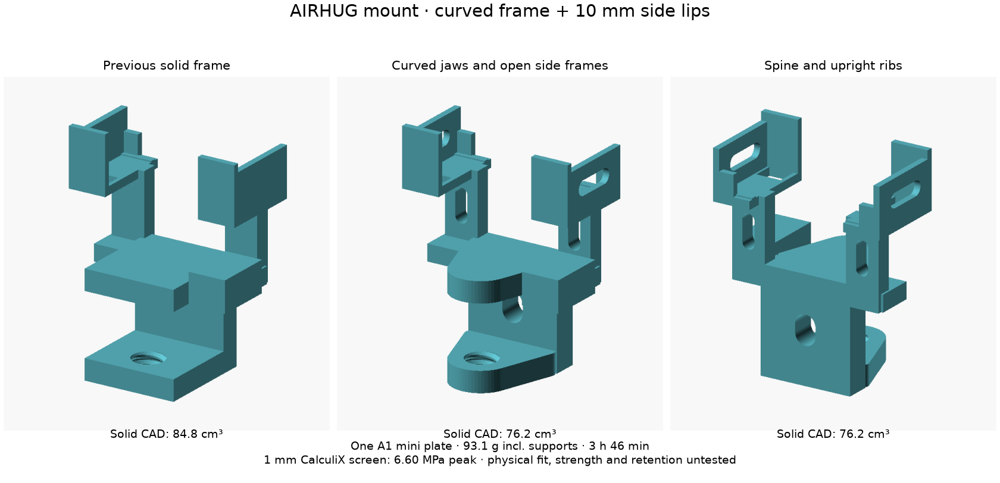
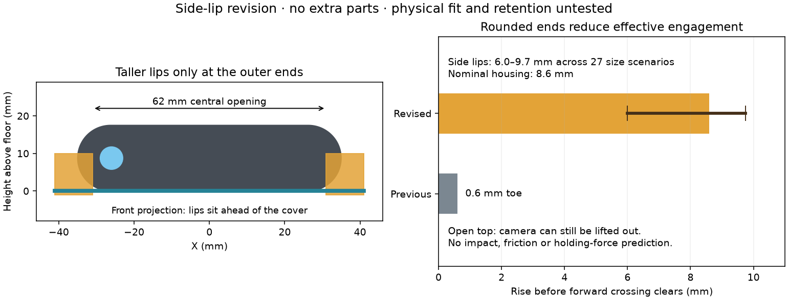

# AIRHUG 02: revised single-plate corner mount

Download [mount-a1mini-pla.3mf](slicer/mount/mount-a1mini-pla.3mf) for the
**curved-frame and side-lip revision**. It contains sliced G-code for one A1 mini plate:
**one clamp, one screw, one pressure pad and two tapered keepers**. No separate
fit-check print or metal hardware is required. Bambu estimates **93 g / 3 h 46 min**,
including supports and brims. Assembly and support removal are
required after printing; this is not a print-in-place mechanism.

Use **A1 mini / 0.4 mm nozzle / Generic PLA / Textured PEI plate**. Open the project
in Bambu Studio and confirm those match your setup. Normal removable PLA supports
and 5 mm outer brims are enabled; detected bridges are left unsupported. The clamp
prints front down. No AMS is needed. All five parts are included
even if you keep using the screw you already printed. Do not scale the project.


## Weight and structural study

The [latest structural and slicing study](OPTIMIZATION.md) combines the **10 mm
side lips** with **curved, tapered jaws**, rounded openings in the spine and
camera uprights, and open side frames around the saddles. A **12 mm deep spine**
keeps material in the clamp's main bending region; the body remains 44 mm wide.
The lower jaw ends in a 28 mm diameter boss around the unchanged screw thread.
The clear ledge opening, cradle floor, keeper slots and front lips retain their
positions. No extra parts or hardware are needed.



The complete print uses **93.1 g / 3 h 46 min**, including supports and brims:
**3.7% less filament but about 3½ minutes longer** than the preceding solid
44 mm frame (96.7 g / 3 h 43 min). Compared with the 118.0 g / 4 h 16 min
side-lip baseline, this saves **21.1% filament and 11.8% estimated time**.
Five walls, 30% gyroid, normal supports and front-down printing remain enabled.
The side windows cost some toolpath time in return for the more open geometry.

Linear elastic CalculiX checks use the same assumed clamp/camera/cable loads as
the earlier study. They screen the new shape; they do not establish printed PLA
strength, grip, impact resistance or creep life. The earlier rectangular design
can be exported with `sculpted=false`; reslice any CAD change.

## What changed and why

The [five-photo audit](DIMENSIONS.md) supports a nominal housing near
**70 × 17.5 × 25 mm**, replacing the incorrect 65 × 16.1 × 10 mm model.
The reference camera now illustrates an exposed left lens, cover shifted right,
and folded clip. Hidden details and cover travel remain approximate.

The new saddles have **76 mm clear width and 32 mm toe-to-back opening**,
a flat support floor, the original low toe, and **10 mm tall front lips at
X = ±31–41 mm**. The **62 mm central opening** leaves the illustrated lens clear;
the top stays open. The taller lips join the end walls and sit at Y = −19 to
−16 mm, ahead of the illustrated cover, rather than growing across its face.
The middle leaves a **45 mm wide** opening behind the housing for the original
clip and cable. Through-slots let the two long keepers slide down behind the
body; their **1–11 mm taper over 36 mm** takes up depth differences. Their top
caps are handles, not a positive latch. They retain the camera by friction.
The camera need not match a tightly fitted capsule cavity.

The female thread's radial allowance is reduced from **0.35 to 0.25 mm** based
on your slightly loose fit report. The screw geometry stays the same, so your
existing screw is reusable. No detents or bumps were added: thread preload
comes from tightening against the pressure pad. This modest change does not
establish holding force or long-term resistance to loosening. The pressure-pad
socket is widened to clear the screw shoulder when its tip bears on the socket
roof; a separate seated-pad intersection check covers this.

Computer checks cover **27 housing scenarios**: widths 66/70/74 mm, heights
16/18/20 mm and depths 23/25/28 mm, with the body front at Y = −14 mm and its
bottom at Z = 70 mm. They check housing/clamp intersection and available keeper
travel, plus a separate 44 × 55 × 27 mm clip keepout. These are chosen design
scenarios around the photo estimates, **not measured tolerance bounds**. They
do not verify the actual clip shape, cover travel, friction or physical fit.
The open space between end stops also permits some lateral play; centre the
housing before seating the keepers. Small removable tape pads can take up
residual side play if necessary.

## Does the front lip prevent dislodging?

**Taller lips at the sides are a useful, simple improvement for forward bumps.**
The earlier strap recommendation was too broad: it addressed unrestricted
lift-out without first improving the tiny forward stop. This revision raises
only the outer ends to **10 mm above the floor**, keeping drop-in assembly and
adding no parts. The keeper adjustment mechanism retains its dimensions.



The rounded ends matter. A 10 mm lip does not provide 10 mm of engagement:
independently constructed capsule housings require **6.0–9.7 mm of straight
upward travel** before they can cross the lips forward (**8.6 mm nominal**),
versus the previous 0.6 mm toe. Direct sideways crossings are also blocked in
both directions across the same 27 housing scenarios, despite the new side-wall
windows. The [reproducible mesh check](check_retention.py)
tests all 27 width/height/depth combinations seated, translated 4 mm forward,
and just below/above their calculated clearance thresholds. All seat without
interference; all seated forward crossings are blocked. The
[report](evidence/retention.json) also repeats the nominal camera-and-keepers
vertical escape check and records mesh hashes.

This is a geometric bump stop, **not a positive lift latch or a prediction of
impact resistance**. The checks cover centred, unrotated housings; rocking,
lateral displacement, combined escape paths, friction and deformation are not
modeled. The open top still allows deliberate removal. The keepers take up
front-to-back play; they do not latch into the guides. A roof or snap hooks
would constrain removal and depend more heavily on the uncertain housing and
cover dimensions, so the side lips are the smaller revision to try first.

The illustrated camera and cover clear the revised clamp, but their real travel
and lens field of view remain unmeasured. Centre the camera, exercise the cover
fully, and check the live image for edge obstruction. Gently check forward,
sideways, rocking and upward movement after seating the keepers. These lips
address forward escape; if resistance to upward cable pulls is needed, this
open-top design alone does not establish it. Physical fit and retention have
not been tested.

Before the weight study, the side-lip revision used **118.00 g / 4 h 16 min**, including supports
and brims, versus **117.51 g / 4 h 15 min** before: approximately **0.49 g and
92 seconds extra** with identical print settings. These are slicer estimates,
not measured print results.

## Print and assemble


1. Print the complete mount plate. Let it cool, then remove brims and supports,
   especially from the female thread, keeper slots, cradle and pressure-pad
   socket. Do not drive the screw through support debris.
2. Start the screw by hand through the lower jaw and run it several turns.
   If it binds, clear debris and check the thread; do not force it. Place the
   loose pad on its tip, **socket down**. The screw is a custom 16 mm major,
   4 mm pitch trapezoidal thread, not an ISO M16.
3. Slide the clamp onto the ledge until the spine meets the lip and the left
   stop meets the jamb (camera centre 41 mm from the jamb). It needs **38 mm clear reach** above and below the
   ledge and a roughly **10–25 mm thick** ledge. Hand-tighten lightly with at
   least two full turns engaged. Check the clamp's grip before adding the camera.
4. Fold the camera's existing clip into the centre opening, keeping the cable
   free. Lower the housing onto the saddles, with the lens facing away from
   the ledge. The floor is 40 mm above the ledge surface; the nominal optical
   centre is about 49 mm above it. No pan/tilt joint is provided.
5. Insert a keeper at each rear slot, **thin tip down, flat back against the
   rear wall, cap projecting toward the camera**. Alternate gentle pressure on
   the two caps until play is removed. Insertion depth varies with the real
   housing; the illustration is an example, not an insertion-depth target.
   Do not force them or crush the shell. Pull the caps up to remove.
6. Check the full cover motion and live image, then gently check for rocking
   and lift. If the camera or clamp moves, correct the fit before leaving it
   installed. Route cable slack so it cannot tug the camera. Mark the contact
   position and recheck the saved projected-screen corners after reinstalling.


The goal is one print job with enough adjustment to accommodate the photo
uncertainty. **A first-print physical fit cannot be guaranteed remotely.** The
real camera, ledge, clamp holding force, print quality and PLA creep have not
been tested. Keep it away from projector exhaust.

`corner_side=-1` selects the supplied left stop; `+1` selects right; `0` removes
it. Any change needs regeneration and slicing. The floor/clearances are defined
in [mount.scad](mount.scad). Historical face-only fits and the old animation in
previous commits describe the superseded prototype, not proof of this fit.

## Fit-check pieces already printed

Your original printed gauges have **65.6 mm width and 10.6 mm depth openings**;
they describe the rejected dimensions. Keep the screw; do not force those gauges
onto the housing. The newly regenerated [optional fit-check plate](slicer/fit-check/fit-check-a1mini-pla.3mf)
has **70.6 mm width and 25.6 mm depth openings**, and the revised female thread.
It is not required before this complete plate and does not represent the larger
adjustable cradle openings. Its depth gauge may be too small for the upper end
of the 24–26 mm photo estimates.


## Reproduce and inspect

Used OpenSCAD 2021.01 and official
[Bambu Studio 02.08.02.61 Ubuntu 24.04 AppImage](https://github.com/bambulab/BambuStudio/releases/tag/v02.08.02.61),
extracted under `/tmp`. Scripts do not download installers automatically.

```bash
python -m pip install numpy scipy pillow matplotlib opencv-python-headless trimesh manifold3d shapely mapbox-earcut
python cad/airhug02/build.py /tmp/squashfs-root/AppRun
python cad/airhug02/validate.py
python cad/airhug02/check_retention.py
python cad/airhug02/preview_retention.py
python cad/airhug02/preview_toolpaths.py
python cad/airhug02/preview_fit_check.py
python cad/airhug02/animate_assembly.py
python -m unittest discover -s cad/airhug02 -p 'test_*.py'
python -m py_compile *.py cad/airhug02/*.py
```

[Validation report](evidence/validation.json) records mesh topology, independent
housing scenarios, clip keepout, nominal reference-camera intersection, modeled
thread clearance over 15 mm of travel, seated-pad clearance, single-plate object inventory/bounds, embedded machine/PLA
settings, slice estimates and artifact hashes. Slicer success is not a print
or hardware test. Profile snapshots are in `slicer/`: 0.20 mm layers, five walls,
30% gyroid infill, five top/bottom layers and normal supports (except detected bridges), using manufacturer
PLA temperatures/cooling/motion. Actual extrusion paths are plotted because GUI
thumbnails are unavailable headlessly. No game or camera/projector calibration
was run.

Bambu profile snapshots and embedded profile data derive from Bambu Studio
02.08.02.61, copyright Bambu Lab and contributors, under AGPL-3.0; see
[slicer/BambuStudio-LICENSE.txt](slicer/BambuStudio-LICENSE.txt) and
[matching upstream source](https://github.com/bambulab/BambuStudio/tree/v02.08.02.61/resources/profiles/BBL).
New CAD and helper scripts use the repository's license.
