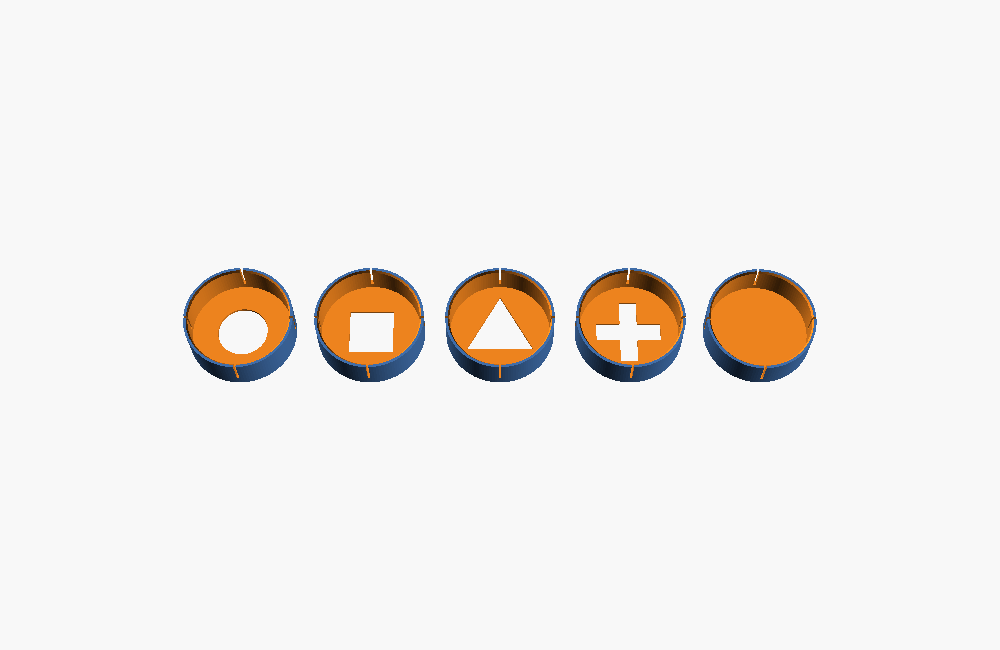
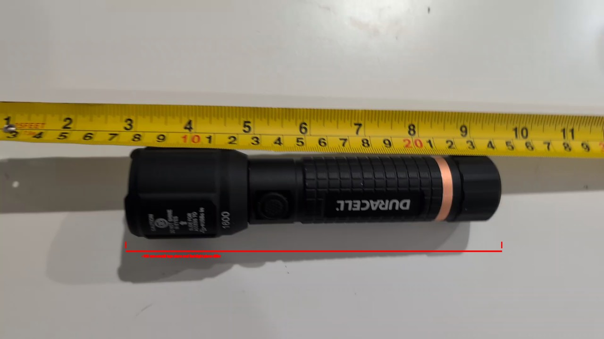
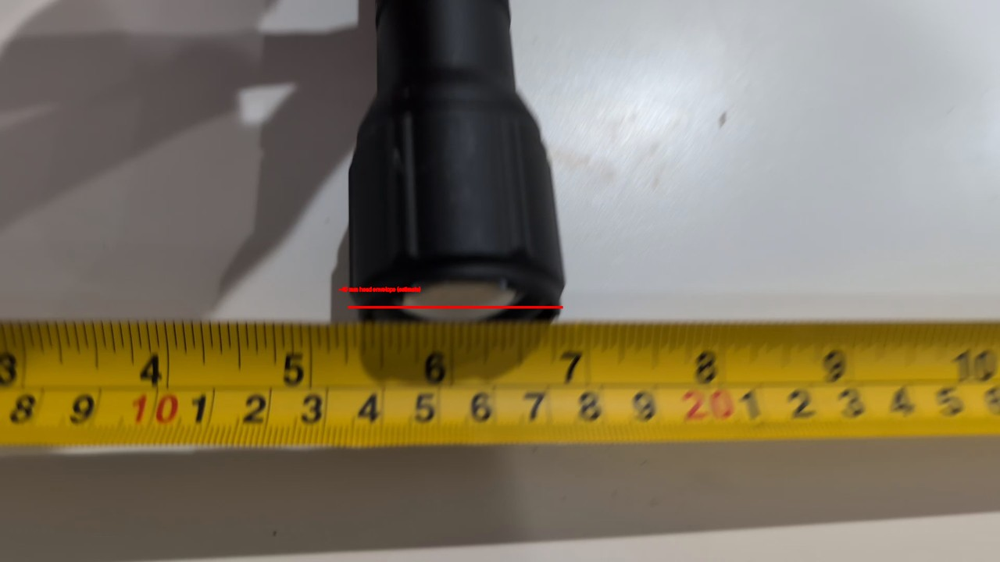
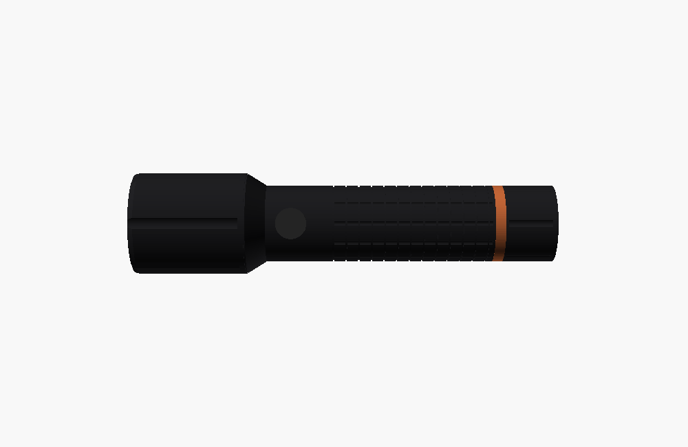
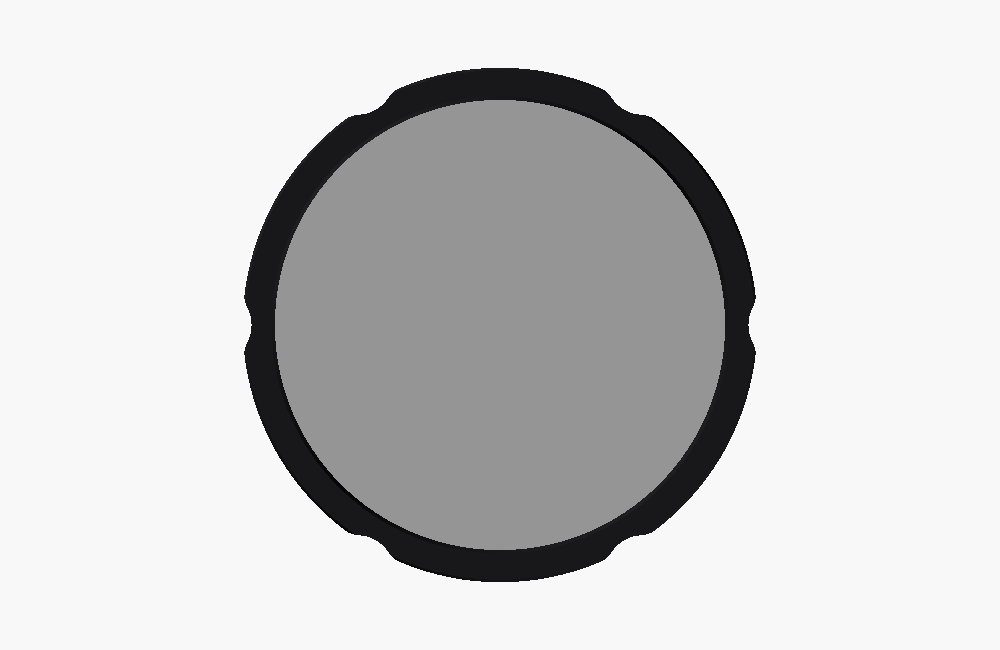
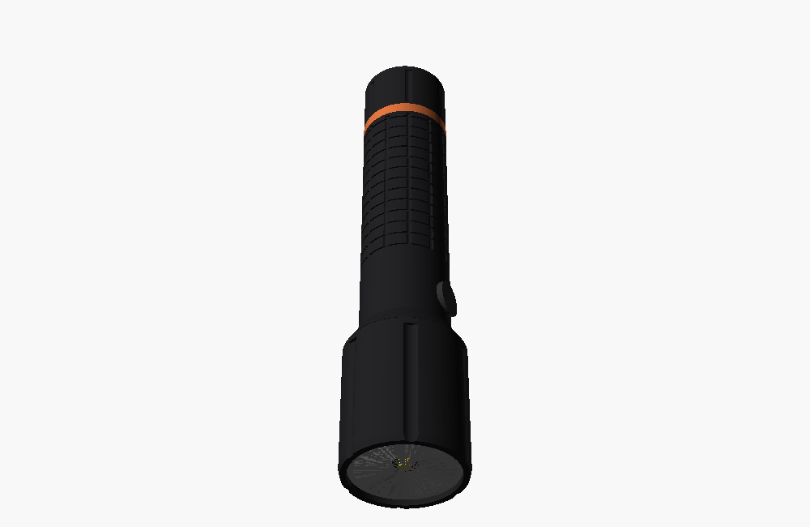

# Duracell flashlight covers — issue 5

Video-derived reference model, **four aperture shapes**, and a **fully filled 0.20 mm diffuser face**, with three mounting options. All dimensions are millimetres. These are first-fit prototypes: the tape supports approximate dimensions, not the submillimetre tolerances of a finished press fit.



## Download and start printing

**A1 mini / PLA:** [Bambu Studio slicing trial](bambu/README.md) includes 22 sliced
3MFs, exact profiles, per-part estimates, and reproduction commands. Physical
printing and fit remain untested.

The [STL directory](stl) contains individual, already oriented parts. GitHub's STL viewer lets you rotate the flashlight and every cover. Download the raw STL for your slicer. No CAD software is needed to print the supplied versions.

1. Measure the flashlight head across the highest lands, not down inside a flute. The supplied models assume **40.0 mm**.
2. Print the six small `fit_*.stl` rings, or the subset nearest your measured diameter. Filenames give the **diametral offset from 40 mm**: `fit_-0p1` has a 39.9 mm bore, `fit_+0p4` a 40.4 mm bore. Keep each ring identified when removing it from the bed.
3. Test on the unlit flashlight. Start with the largest ring and move down. Stop if a ring needs force or starts whitening/cracking. Rings test the bore and entry bevel; longer cover skirts can grip more firmly.
4. Start with [flex_circle.stl](stl/flex_circle.stl). If your successful ring differs from its 40.3 mm bore, update `head_d` and `clearance` in [flashlight.scad](flashlight.scad), then export the cover. A fit coupon is intentionally much cheaper than a full cover.
5. Print the remaining shapes and the filled face after confirming fit. Test the actual beam on the play surface at game distance before choosing player IDs.

The STL reference flashlight is for inspection and fit planning, not a functional flashlight or replacement battery enclosure.

## Included designs

| File prefix | Bore at defaults | Attachment |
| --- | ---: | --- |
| `flex_` | 40.30 mm | Four slits form flexible skirt fingers; slide over the front 14 mm of the grooved head. Clearance allows easy initial fitting; reduce it after a coupon test if loose. |
| `press_` | 39.90 mm | Continuous 1.6 mm wall with 1 mm entry bevel. The nominal 0.10 mm interference asks for about 0.25% circumferential expansion over a 40 mm land. Actual stress/retention depend on printing and the real head profile. |
| `strap_` | 40.60 mm | Slotted loose sleeve with an external 3 mm wide, 0.6 mm deep band channel. Use a narrow elastic band, reusable strap, or lightly tensioned cable tie to squeeze the fingers against the lands. No screw hardware required. |

Each prefix has `circle`, `square`, `triangle`, `cross`, and `filled` variants: **15 covers total**. These sleeves grip the outer lands by friction; they do not assume an accurately measured snap groove or reproduce an unobserved screw thread. The 14 mm skirt stays on the front head section, away from the side switch and sliding-head interface.

| Optical face | Geometry | Thickness |
| --- | --- | ---: |
| Circle | Ø20 mm aperture | 1.20 mm |
| Square | 17.72 mm side | 1.20 mm |
| Triangle | Equilateral, 26.94 mm base × 23.33 mm high | 1.20 mm |
| Cross | Two 26 × 7 mm bars | 1.20 mm |
| Filled | Continuous disk across the entire bore; no aperture | **0.20 mm** |

Open areas are approximately equal (314–315 mm²) so gross aperture area is similar across shapes. Equal area does not guarantee equal transmitted flux. The filled variant has the same sturdy 1.6 mm sleeve wall as the others, with only the optical face reduced to one layer. It is not a zero-infill/open membrane.

`loose_diffuser_disk.stl` is an additional 0.20 mm film disk for trying translucent filament behind an aperture face. Drop it into the cover before installation; the installed flashlight traps it against the face. This is an external insert, not a claim that the flashlight bezel unscrews or that an internal retaining thread fits. Its diameter is `head_d + clearance - 0.5` (39.8 mm by default).

## Printing and optical use

- Supplied covers stand with the flat optical face **on the bed**, sleeve opening upward. No supports or bridging across the face are required. Rings and loose disk also lie flat. Leave model scale at 100% in millimetres.
- A 0.4 mm nozzle, 0.20 mm first layer and 0.20 mm layer height are the intended starting settings. Use solid faces and at least four wall lines for the 1.6 mm skirt; inspect the slicer preview. The filled face must show one continuous first layer over the bore. Disable a brim on the one-layer film if removal damages it; keep it on the outer sleeve if needed.
- Print aperture covers in opaque filament to reduce light leaking through the masked region. Print filled covers/disks in natural/translucent or translucent colored filament. Transmission and color depend strongly on the filament and layer extrusion; neither has been measured here.
- Near-lens apertures **may not project sharp shapes** through this flashlight's optics. Try focus/zoom positions and game distance. The shapes are candidates for player markers, not validated recognition targets. No game detection code has been changed.
- Begin optical trials at low output and check the cover temperature during short runs. High output can heat an absorbing mask and loosen PLA. The video gives no cover temperature or material limit; continuous full-power operation has not been established. The one-layer face is particularly fragile. Do not use a cracked cover or a fit that interferes with the flashlight controls.

## Reconstruction and evidence

Source: [issue 5 video attachment](https://github.com/user-attachments/assets/2272c56f-69a0-4caf-87f7-e921c7834187). Reviewed the roughly 72 second clip at four-second intervals and inspected the full-resolution tape and close-up views. Selected compressed frames are kept in [reference](reference); the 76 MB video is not duplicated in the repository.




| Feature | Working dimension | Basis / uncertainty |
| --- | ---: | --- |
| Overall length | 165 | 0 s view: front near 7.5–8 cm, tail near 24 cm. 8 s view gives closer to 160 mm. Allow roughly ±8 mm because the tape and cylinder are at different depths and views have perspective. |
| Maximum head diameter | 40 | 16 s: head spans approximately 13.5–17.5 cm on the tape. Allow roughly ±2 mm; this is the critical dimension to replace with a caliper measurement. |
| Head to neck transition | 52 | Scaled from 0/8 s side silhouettes; roughly ±4 mm. |
| Grip/neck diameter | 30 | Ratio to head in the side views; roughly ±3 mm. |
| Front optical opening | 35 | Estimated opening/head ratio from 32/48/52 s views; roughly ±2 mm. |
| Copper band | 4 wide, 24 from tail | Side views; cosmetic estimate, roughly ±2 mm. |
| Head flutes | 6, 1 mm nominal depth | Symmetry inferred from rotating views at 20–36 s and front views. Count/depth are approximate; not a measured mating feature. |
| Switch / grip texture | 12 mm button, 5 mm grip pitch | Visual proportions only. Cosmetic details, not mounting datums. |

The model includes the stepped/tapered head, front bezel recess, approximate reflector/lens rim/LED, head flutes, neck, side switch, circumferential and longitudinal grip grooves, copper tail band and tail cap envelope. Lens/reflector surfaces are illustrative; internal electronics, optical prescriptions, lettering, hidden threads, exact grip pattern and battery internals are not reconstructed. The closed reference mesh fills its interior rather than attempting unobserved internal cavities.





The side render uses the video's head-left orientation and shows the relative head, switch, grip and tail lengths. The preview renderer hides the illustrative lens rim to expose the illustrative reflector and LED. The front render checks the circular opening and flute silhouette; the oblique render and turntable expose the head transition. These are visual comparisons, not camera-calibrated photogrammetry or a claim of exact pose registration. Open the reference STL or SCAD to freely rotate it alongside the video.

## Edit and reproduce

[flashlight.scad](flashlight.scad) is the editable source of truth. Set `part` to `reference`, `cover`, `coupon`, `disk`, `lineup`, or `assembly`; choose `mount` and `aperture`. In OpenSCAD, F5 previews and F6 renders; export the selected part as STL. `clearance` is diametral, not radial. Change `membrane` to match your intended first-layer height if it is not 0.20 mm. `assembly` shows a cover over the head with 1 mm between bezel plane and inside face.

Example custom fit:

```sh
openscad -o custom-square.stl -D 'part="cover"' -D 'mount="flex"' \
  -D 'aperture="square"' -D 'head_d=40.2' -D 'clearance=0.1' \
  hardware/flashlight/flashlight.scad
```

To regenerate all supplied STLs and the geometry report, install OpenSCAD and Python packages `numpy trimesh`, then run from the repository root:

```sh
python hardware/flashlight/build.py
```

The script exports 23 STLs and checks watertightness, positive volume, one connected surface, bed placement, aperture center clearance, and the actual 1.20/0.20 mm optical face thickness, recording dimensions and volume in [validation.json](validation.json). This validates mesh geometry, not printability on every printer, physical fit, thermal behavior, beam shape, or camera recognition. STLs have no intrinsic unit metadata; import as millimetres.

For reproducible previews and the turntable, additionally install `xvfb` and Python package `pillow`, then run `python hardware/flashlight/render.py`. The video stills were extracted separately from the linked attachment at the timestamps in their filenames; annotated red spans are approximate visual measurements.

Repository Python syntax was checked with `python -m py_compile *.py hardware/flashlight/*.py`. The camera/projector game, physical prints, fit and light tests were not run on this runner.
