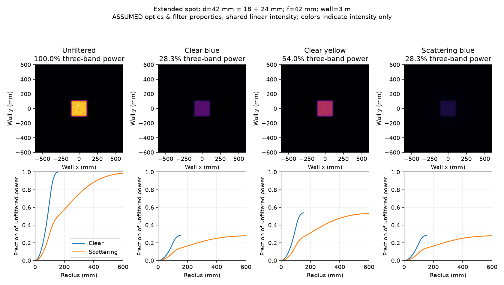
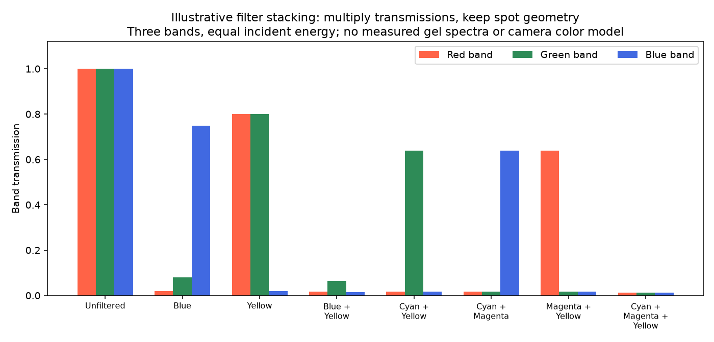
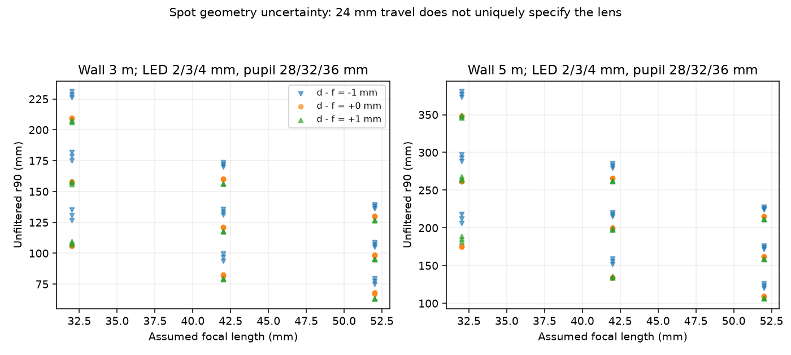

# Color filters on the extended Duracell spot beam

A smooth, spatially uniform, non-scattering color filter preserves the modeled
spot footprint while reducing and recoloring its light. A scattering sheet can
keep a bright central core while sending much of the light into a broad halo.
Stacking clear filters multiplies their wavelength transmissions; it does not
require retracting the flashlight to flood mode.

This study incorporates the owner's **approximately 24 mm additional extension
relative to the original video** in [issue #5](https://github.com/sgbaird/balloon-pop-game/issues/5).
It is a reproducible first-order simulation of the same **sliding positive lens
and finite LED arrangement**, **not an exact reconstruction of the Duracell lens**.
The true lens prescription, principal planes, clear aperture, emitter dimensions
and absolute LED-to-lens spacing remain unknown. The numbers below are conditional
on explicitly assumed inputs, rather than predictions for a measured unit.

## Geometry and the 24 mm correction

The earlier [optics investigation](https://github.com/sgbaird/balloon-pop-game/pull/12)
identified the probable unit from the video as the Duracell 1,600L hybrid 3-pack.
The manufacturer's [product page](https://myproduct.duracelllights.com/products/1600-l-hybrid-power-flashlight-3pack)
confirms adjustable spot/flood output. It does not publish the optical dimensions
needed to specify an exact ray trace. The SKU identification remains provisional.

| Input | Nominal value | Basis |
| --- | ---: | --- |
| Extra lens travel from video position | 24 mm | Owner's approximate estimate; not a measured tolerance |
| Video-position LED to lens principal plane | 18 mm | Assumption, not measurable directly through the curved lens |
| Extended spot spacing `d` | 42 mm | 18 + 24 mm; assumes the lens moves with the sliding head and LED stays fixed |
| Effective focal length `f` | 42 mm | Hypothesis that the extended setting approximately collimates each LED point |
| Clear pupil diameter | 32 mm | Assumption inherited from the previous study, not the head's outer diameter |
| Emitting surface | Uniform 3 mm square | Assumption; no LED part number or emitting-area measurement |
| Lens to wall | 3,000 mm | Example play distance |
| Lens to filter | 50 mm | Computational example only; not a recommended mounting or thermal clearance |

The old illustrative focal length of 30 mm was **not** a measurement. Adding
24 mm to an assumed retracted spacing while retaining that focal length would
not establish a correctly focused spot. Here the default focal length is
`video spacing + extension`; specifying `--focal-mm` makes it independent. This
is an explicit collimated-spot hypothesis, not a focal length inferred from travel
alone. Extended head length is also not the same as distance to a lens's principal
plane.

For LED position `s`, lens-pupil position `p` and wall distance `L`, in each axis:

```text
d = d_video + extension
outgoing slope = (p - s)/d - p/f
wall position = p + L * outgoing slope
              = [1 + L(1/d - 1/f)] p - (L/d) s
```

These follow [thin-lens imaging geometry](https://micro.magnet.fsu.edu/primer/java/components/characteristicrays/index.html).
At `d=f`, each source point is collimated, but the finite LED still spreads the
beam. To focus the LED exactly onto a wall at 3 m instead, the nominal model
requires `d=f*L/(L-f)=42.596 mm`. The sensitivity sweep includes ±1 mm departures
from collimation. A clear uniform filter preserves the normalized footprint at
either setting under the stated model assumptions.

## Results



All top panels share a linear intensity scale and physical field of view. The
false color shows intensity, **not the predicted visible color**. Under each
panel, curves compare clear and scattering versions with that panel's band
transmission. Those curves are hypothetical comparisons, not four measured materials.

`r90` is the radius about the optical axis containing 90% of transmitted power;
it is a radius, not a diameter or the game's image-space ball radius.

| Case | r90 at 3 m | Transmitted three-band energy | Fraction of transmitted energy inside original r90 |
| --- | ---: | ---: | ---: |
| Unfiltered | 121 mm | 100% | 90% |
| Clear blue | 121 mm | 28.3% | 90% |
| Clear yellow | 121 mm | 54.0% | 90% |
| Scattering blue | 417 mm | 28.3% | 41% |

The scattering example assigns 65% of transmitted light independent angular
kicks with Gaussian **4° standard deviation per transverse axis**, using
small-angle slopes, after the filter plane. The remaining 35% stays ballistic.
This is an intentionally illustrative halo model, **not measured cup haze**.
Moving a scattering sheet a few centimetres away does not recover the tight
spot: the angular kicks still propagate almost the full distance to the wall.
A smooth clear sheet has no angular kicks in this idealization. Curved cups,
wrinkles, surface texture or wedge-shaped sheets may also refract/distort the
beam, effects not represented by this model.

The two blue cases have the same integrated transmission by construction but
very different spatial concentration. Thus a bright core and a dim wash can
coexist. Automatic exposure and clipping could further obscure that difference;
no camera response is simulated here.

## Stacking filters for color lessons



The study uses **three educational bands with equal incident energy**, not a
measured LED spectrum, spectral integration, human luminance or camera RGB.
The assumed `(red, green, blue)` transmissions are:

```text
blue    = (0.02, 0.08, 0.75)
yellow  = (0.80, 0.80, 0.02)
cyan    = (0.02, 0.80, 0.80)
magenta = (0.80, 0.02, 0.80)
```

For actual spectra, `S_out(lambda) = S_LED(lambda) * product(T_i(lambda))`.
Here that multiplication is applied separately in each band. Blue + yellow
passes **3.17%** of equal-band incident energy, with green leakage dominant.
Cyan + magenta + yellow passes **1.28%**, equally in the three assumed bands.
That is dark, not mathematically black. These percentages are **not ratings of
any product linked earlier in the issue**. Real spectra and camera sensitivities
are required for predicting camera hue, HSV thresholds or actual brightness.

The [University of Wisconsin color-filter demonstration](https://www.physics.wisc.edu/ingersollmuseum/exhibits/opticscolor/subcolormix/)
explains the ideal subtractive combinations: cyan/yellow gives green,
cyan/magenta gives blue, magenta/yellow gives red, and all three remove all
ideal bands. The nonzero leakage here illustrates why physical filters may not
produce a complete blackout.

## Sensitivity and limits



The CSV sweep contains 243 combinations: 28/32/36 mm pupil, 2/3/4 mm LED,
32/42/52 mm focal length, `d-f = -1/0/+1 mm`, and walls at 1/3/5 m.
Every row records the implied video spacing `d-24 mm`. These ranges are
**hypotheses, not measured bounds or confidence intervals**. The sweep changes
absolute geometry while retaining the reported travel. It demonstrates why
24 mm alone cannot determine a unique spot size. Only the 3 m and 5 m slices
are plotted; all distances are in the CSV.

The ray model samples source and pupil positions, with Lambertian-to-pupil
weights proportional to `d² / (d² + |p-s|²)²`. Weights are normalized for each
geometry, so cross-geometry results describe footprint rather than absolute
light collection. Even this weighting cannot correct the thin-lens/paraxial
approximation at the large edge angles of a fast flashlight lens. No thick or
aspheric surfaces, aberrations, wavelength-dependent focus, reflections,
diffraction, housing clipping, filter aperture clipping, wall reflectance,
heat or sensor response are modeled. The filter is assumed to cover every ray;
its sample gap is used only to locate angular scattering. Adding a tilted or
refracting plate could shift focus and is outside this simulation.

To match the actual unit, obtain the lens prescription or measure an effective
focal length, the clear diameter, the emitting area, absolute principal-plane
spacing, and beam footprints at two known wall distances. A front-view video
through the lens cannot uniquely supply these. Actual LED spectra and candidate
filter transmission/haze measurements are needed to replace the educational
band and scattering assumptions.

This simulation does not establish safe filter placement or temperatures.
The earlier heat discussion in the issue still applies: Duracell's
[safety guidance](https://myproduct.duracelllights.com/pages/safety-precautions)
warns against covering the light/lens area. The modeled 50 mm gap is not safety
validation. No attachment, material or operating duration is approved by this
calculation. Classroom stacking can be demonstrated separately with a suitable
low-power teaching source.

## Reproduce and checks

```sh
python -m venv /tmp/filter-sim-venv
/tmp/filter-sim-venv/bin/pip install numpy==2.5.4 matplotlib==3.11.2
/tmp/filter-sim-venv/bin/python hardware/flashlight/filter_simulation/simulate.py
```

`--help` lists geometry, scattering and output controls. The fixed seed is 5;
the nominal study uses 400,000 rays and each sensitivity case uses 30,000.
`results/parameters.json` records inputs; CSV files contain numeric results.
The script is standalone and does not require the game, camera or missing
`video_recorder` module. Generated outputs are committed for review.

Checked finite-wall imaging and collimation against analytic equations,
normalized energy conservation, unchanged clear-filter footprint, and known
filter-stack products. A second run at 2 m, with a 100 mm gap and scattering
fraction zero, reproduced the clear-beam r90 and core fraction to floating-point tolerance.
Reviewed all three rendered plots; repository Python compilation and whitespace
checks passed. No physical beam, product-filter, thermal, print, camera,
projector or gameplay tests were run. These checks validate the implementation
against its assumptions, not agreement with the flashlight.
