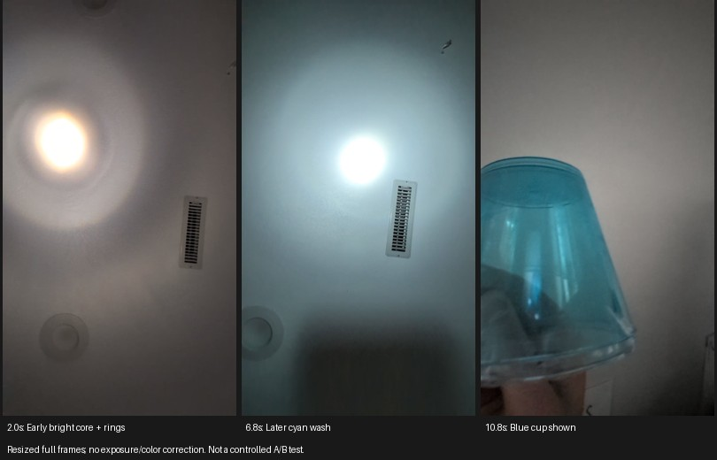

# Colored cups: preserve the color without spreading the spot

**Try a smooth, transparent blue/yellow lighting-filter film held across an
open printed carrier.** The cup experiment shows that changing the beam color
is feasible, but a broad colored wash is a poor substitute for a localized
player pointer. A fully filled, one-layer colored PLA face is also an
uncharacterized scattering material; it is a diffuser experiment, not the
preferred optical window for this goal.

This follows the [cup-video comment in issue #5](https://github.com/sgbaird/balloon-pop-game/issues/5)
and complements the [earlier aperture-optics investigation in PR #12](https://github.com/sgbaird/balloon-pop-game/pull/12).
Those CAD and optics branches are not prerequisites for this note.

## What the new video establishes



The [11.6-second source video](https://github.com/user-attachments/assets/fae3bca4-519b-44e4-a484-5c24a13bfea3)
shows a bright central spot with concentric rings early on, a cyan-colored
region extending well beyond the bright center later, and a blue cup at the end.
The white-looking center appears overexposed. These are observations from the
recording, not measurements of optical transmission or beam divergence.

The recording does not establish a fixed camera exposure/white balance, fixed
flashlight zoom and position, or a labeled uncovered baseline. We therefore
cannot attribute all the halo to diffusion, estimate a scattering angle, or
conclude that the physical center lost its color. Clipping can make a colored
center look white, and camera flare can contribute to a halo. The observed
cyan wash is consistent with the reported spreading, but is not a controlled
measurement of its cause.

## Why a colored cup can do this

Color selection and angular spreading are separate effects. An absorptive
filter removes some wavelengths; a diffuser redirects rays. Edmund Optics
describes [absorptive filters](https://www.edmundoptics.com/knowledge-center/application-notes/optics/optical-filters/)
and separately offers [colored glass with a deliberately scattering surface](https://www.edmundoptics.com/f/colored-glass-diffusers/39587/).

For this cup, plausible contributors are surface texture, material haze,
molded features, and curved walls refracting light into other directions.
The video does not distinguish these mechanisms. Even a visibly transparent
cup can redirect rays through its curved surfaces; visually translucent
plastic and printed extrusion lines can also scatter them. Making PLA thinner
can reduce attenuation, but does not establish low haze or optical flatness.
Increasing cover thickness helps neither spot localization nor focus.

A small angular spread can become substantial at play distance:
`extra halo radius ≈ distance × tan(scattering half-angle)`.
For illustration only, 5° at 3 m gives about 0.26 m of additional radius.
Neither that angle nor that distance was measured from the clip.

This differs from the aperture problem: a lens-plane shape need not be imaged
onto the wall, whereas a full-face color filter changes the spectrum of rays
passing through it. A smooth plane-parallel film should preserve direction
much better than a hazy or curved cup, subject to wrinkles, surface quality,
and its actual scattering properties. That is an engineering expectation to
test, not a validated result on this flashlight.

## The next cover experiment

| Candidate | Role in this experiment |
| --- | --- |
| Existing blue cup | Comparison sample; its current result may suffice for a rough color trial. |
| Clear, smooth blue/yellow lighting gel | Preferred next sample for compact colored spots. Choose a **color-effect** filter, avoiding frost/diffusion grades. |
| Smooth transparent colored sheet | Possible alternative; reject visibly hazy/textured material and test actual camera color. |
| Thin colored printed PLA | Keep as a diffuser comparison; do not assume a single layer preserves a narrow beam. |

LEE identifies its [standard color-effect filters as coated PET film](https://leefilters.uservoice.com/knowledgebase/articles/23055-what-are-the-lighting-filters-made-from).
It also sells [diffusion filters specifically intended to spread light](https://leefilters.com/lighting/diffusion-packs/);
the word “gel” alone does not guarantee low diffusion. Start with small blue
and yellow samples; appearance by eye is insufficient to select a filter for
this LED, wall, projector and camera. No specific grade or transmission has
been validated here.

Print the mechanical holder and leave the entire optical opening empty.
Clamp the separate film by its perimeter between an open sleeve flange and a
retaining ring. Keep it smooth, cover the complete beam path to prevent a
white bypass, and leave clearance from the curved flashlight lens. Size the
opening from the **measured clear lens and actual beam envelope**, not from the
outside head diameter or an assumed CAD dimension. A small opening can
vignette and dim the spot. Do not put a square/cross face in front of the film
when evaluating color alone.

For a first reversible trial, hold the film in an external card frame or tape
its edges to an open carrier; keep adhesive out of the optical opening. A
retaining ring is the more repeatable mounting option once the film passes
the optical test. This note does not add an unverified fit or claim that a
previous printable cover already has a suitable film seat. Begin with brief,
low-output trials and check for film/holder heating or deformation before
sustained operation; this assembly has no thermal validation.

## Compare at the actual play surface

1. Fix flashlight distance, zoom, aim and output. Use the gameplay camera and
   wall. Lock exposure, gain and white balance using the camera's supported
   controls. Lower exposure/output until the brightest sample has no clipped
   channels; retain those settings for the comparison.
2. Record ambient-only, uncovered, cup-covered, clear uncolored film (if
   available), and blue/yellow filter samples. The clear-film control helps
   separate the mounting/material effect from spectral filtering. Include
   projector-on trials after the initial comparison.
3. Compare the spot profile after ambient subtraction, using a common
   unsaturated channel for each sample/baseline pair. Compare normalized
   profiles to separate spreading from dimming; also retain raw counts to
   assess the exposure needed. Camera RGB counts are not optical power.
   Report core width, halo and centroid movement; hold camera processing
   constant. Do not compare independently auto-exposed screenshots.
4. Calibrate blue and yellow from the **reflected spots** at that exposure.
   Inspect the binary color masks, including the center and halo. Move each
   spot around the full surface; check a stationary spot, both spots present,
   crossing spots and one light switched off. Repeat near/far and over bright
   projected content. Record missed detections and false player assignments.
5. Prefer the sample that keeps a compact, stable detected region with good
   color separation under projector illumination. A dimmer well-localized
   spot may be more useful than a bright wash. If every sample has a white
   core, address exposure before judging the material or adding layers.

## What this means for the current game

In [main.py](../../../main.py), `detect_ball()` thresholds calibrated HSV
ranges, cleans the mask and selects the largest eligible contour. It is not
a dedicated flashlight-spot detector. Defaults require area above 200 pixels²
and enclosing radius between **5 and 50 camera pixels**. A broad colored halo
can exceed that maximum, select an off-center region, or merge with another
spot; a clipped low-saturation center may disappear from the color mask.
Human-visible blue/yellow separation therefore does not establish tracking.

`BallTracker` also uses background subtraction in its ROI path and falls back
to a full-frame search without that mask. Test held-still spots as well as
moving ones. The game's existing interaction uses trajectory/direction-change
logic for thrown balls; reliable spot detection alone does not validate a
flashlight aiming or trigger interaction. No detection thresholds or gameplay
behavior are changed by this investigation.

## Reproduce the evidence

```sh
python -m pip install opencv-python-headless pillow
curl -L --fail \
  https://github.com/user-attachments/assets/fae3bca4-519b-44e4-a484-5c24a13bfea3 \
  -o /tmp/issue5-cups.mp4
python hardware/flashlight/filters/extract_evidence.py /tmp/issue5-cups.mp4
python -m py_compile *.py hardware/flashlight/filters/extract_evidence.py
```

The evidence script extracts full frames at 2.0, 6.8 and 10.8 seconds, scales
them to fit and adds captions. It applies no exposure/color correction or
beam segmentation. The video was decoded and reviewed, the evidence image
was generated and inspected, Python compilation and whitespace checks passed.
No physical filter, print, fit, thermal, camera/projector or gameplay test was
performed. The checkout also lacks the `video_recorder` module imported by
`main.py`, so compilation alone does not establish that the game starts.
