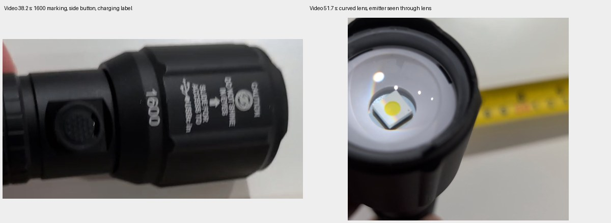
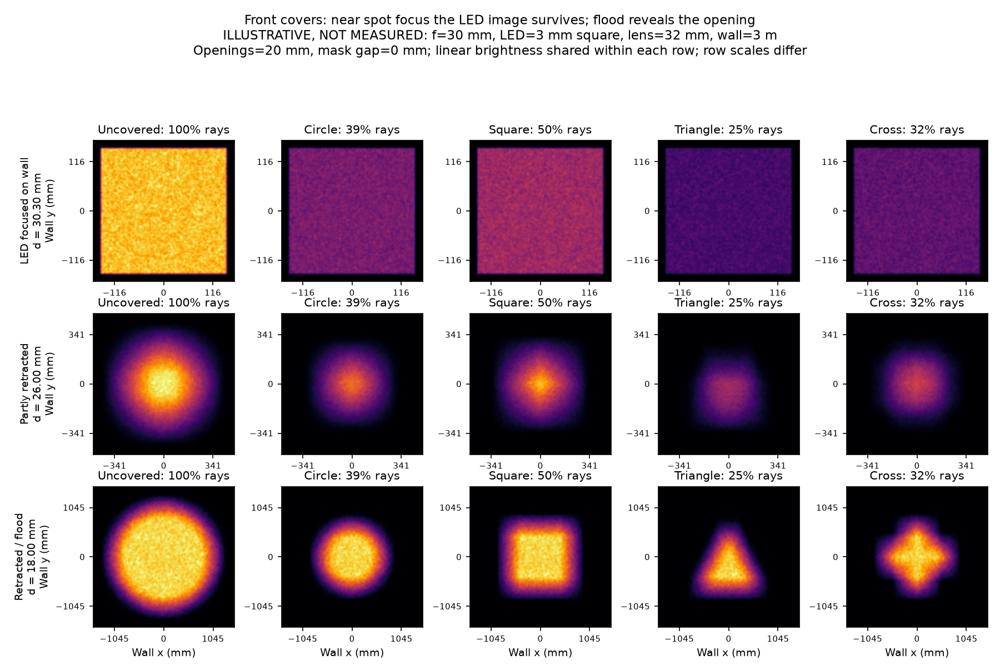

# Why the flashlight cover mostly dims a circle

**The reported behavior is consistent with a sliding-lens zoom flashlight.**
Near spot focus, the lens forms an image of the LED on the wall. A shape cut into
a cover at the lens mostly changes how much of that image gets through. Moving
the lens substantially closer to the LED makes the beam diverge, and the front
opening can then influence the wall outline much more strongly.

That explains why retracting the head helps. It does not mean the earlier printed
apertures will project sharp player-ID shapes at every zoom setting or distance.

## Identification and evidence

The [issue video](https://github.com/user-attachments/assets/2272c56f-69a0-4caf-87f7-e921c7834187)
shows a Duracell body, a **1600** marking and USB charging instructions near 38 s,
a side button, a copper band near the tail, and a large curved front lens over
a small yellow emitter near 52 s. The visible LED is viewed **through the lens**;
its apparent size and depth do not directly measure its actual size or spacing.
The video shows the hardware, not a wall-beam test of the covers; the cover
behavior comes from the issue comment.



The strongest match is the **Duracell 1,600L Dual Power / Hybrid LED Flashlight
3-pack**, Costco item **1938066**. The manufacturer's [product page](https://myproduct.duracelllights.com/products/1600-l-hybrid-power-flashlight-3pack)
describes adjustable spot/flood output and hybrid USB-C/AAA power. Its linked
[manual](https://duracell-lights-support.b-cdn.net/3%20Pack%201600%20L%20Duracell%20Flashlight%20Online%20Manual%20Item%231938066.pdf)
identifies that item and describes sliding the head to change focus. The
[Costco listing](https://www.costco.com/p/-/duracell-1600-lumen-hybrid-power-led-flashlight-3-pack/4000449524)
lists 157 × 41.2 × 31.6 mm, compatible with the video's approximate size and
earlier CAD estimates. **This is a strong visual match, not a verified SKU read
from the flashlight.** None of these sources supplies a lens prescription,
focal length, emitter size, or a front-optics disassembly procedure.

## A simple ray model



This is an **illustrative paraxial model, not a calibrated model of this unit**.
It uses an ideal positive thin lens, a uniformly emitting square LED, and opaque
front masks. Illustrative inputs are a 32 mm clear lens, 3 mm LED, 30 mm focal
length, 20 mm openings, and a wall 3 m away. These optical dimensions are assumed;
the external 41.2 mm head dimension is not the clear lens diameter.

For one transverse coordinate, let `s` be a point on the LED, `p` the ray's
position on the lens, `d` the LED-to-lens distance, `f` the focal length, and `L`
the lens-to-wall distance. Straight propagation and thin-lens refraction give:

```text
outgoing slope = (p - s)/d - p/f
wall position  = A p - (L/d) s
A              = 1 + L(1/d - 1/f)
```

This is the same imaging geometry as the [Florida State University thin-lens
ray tutorial](https://micro.magnet.fsu.edu/primer/java/components/characteristicrays/index.html).
It also makes the front-mask behavior explicit:

| Lens position | What determines the wall pattern? |
| --- | --- |
| `d = f L/(L-f)` | `A = 0`: wall position is independent of which part of the lens the ray used. Each open region contributes to the same LED image. |
| `d = f` | Rays from each LED point are collimated; the finite LED still gives angular spread. At finite distance, the pupil term remains `A = 1`. |
| `d < f`, substantially retracted | `A` grows positive: the front opening's outline is enlarged, convolved with blur from the finite LED. |

For a mask directly at the lens, the scale of its outline is `abs(A)` and the
LED blur width is `L * LED_width / d`. At 3 m, the example gives:

| Setting | LED–lens spacing | 20 mm opening scale on wall | LED blur width |
| --- | ---: | ---: | ---: |
| LED focused on wall | 30.303 mm | 0 mm | 297 mm |
| Partly retracted | 26 mm | 328 mm | 346 mm |
| Flood | 18 mm | 1,353 mm | 500 mm |

The zero in the first row means the opening's shape disappears from the mapping;
the LED image still has finite size. The simulation uses a square LED, so its
spot is square rather than matching the reported circle. Actual emitter shape,
defocus, lens aberrations, scatter and camera saturation can round or wash out
that detail. **The supported conclusion is loss of the cover's shape near spot
focus, not an exact prediction of a circular footprint.**

An opaque mask should still reduce total light. Under the model's uniform pupil
illumination, a 20 mm circular opening in a 32 mm lens passes about **39%** of
rays. If a cover seems to dim the beam only slightly, check exposure and opacity:
perceived or automatically exposed brightness is not proportional to power.
A translucent print can also pass light through the supposedly blocked area.
A complete opaque cover must block the direct beam at every zoom setting;
light remaining around one points to leakage or transmission, not focusing.

### Scope of the approximation

The script samples independent uniform LED and pupil positions with equal ray
weights. This is a first-order radiance approximation, not full Lambertian
weighting at large angles. A real wide, strongly curved lens is outside the
paraxial regime at its edges. The model omits thick/aspheric surfaces, housing
vignetting, reflections, diffraction, spectral effects, filament scattering,
thermal effects and camera response. Flux fractions are relative to the
uncovered beam **at the same setting**, not lumens or brightness comparisons
between zoom settings. Color scales and wall fields are shared within each
row, but change between rows. Light smoothing only reduces sampling noise.

## Would putting a shape behind the lens work?

**Only if it can be put in a plane that the lens can image onto the wall and is
illuminated across the whole shape.** This is a projection mask (often called a
gobo), rather than a pupil mask. For a wall at `v`, its distance behind the lens
must be `u = f v/(v-f)`, slightly greater than `f`. In the 30 mm / 3 m example,
`u = 30.303 mm`.

Putting material immediately behind the lens, a few millimetres from it, usually
puts it *inside* the focal length: it does not form a real focused image on the
wall. Near spot focus the useful object plane is already near the LED, so an
internal mask would be tiny, difficult to illuminate independently of the LED
outline, and mechanically constrained. Masking the emitting surface could
change the projected source shape but would throw away light and require access
the video does not establish. There is no basis here to assume a removable
front bezel or to recommend inserting PLA against the LED.

## Practical paths for player IDs

| Approach | Expected result and tradeoff |
| --- | --- |
| Retract to flood, use an opaque external mask, and hold that zoom position | Simplest shape experiment; expect large, soft patterns. Choose coarse circle/square/triangle/cross features and test at the actual play distances. |
| Use full-face blue/yellow transmissive filters | Changes the spectrum of every transmitted ray, so it does not rely on projecting the cover's outline. This matches the game's existing blue/yellow detection concept. Filter transmission and camera thresholds still need measurement; thin colored PLA is not a characterized optical filter. |
| Add an external mask **and a second positive lens** in an adjustable tube | Can form a focused mask image without opening the flashlight. Use the flashlight on flood to illuminate the mask; place the mask slightly more than one focal length *before the added lens*. A bare standoff mask alone has no new focusing element. |
| Insert an internal gobo | Optically possible only with the right image plane and illumination; the least accessible option for this hardware. |

For the external projector, a purely illustrative `f2 = 50 mm` lens aimed at a
wall 3 m beyond that lens needs the mask **50.85 mm behind it**, giving about
59× magnification. A 10 mm opening would make a roughly 590 mm image. Focus
travel matters: at a 2 m wall the separation becomes 51.28 mm. These are
principal-plane distances; a thick physical lens needs adjustment rather than
a fixed dimension copied from the formula. Lens diameter, illumination cone,
aberrations and mounting alignment determine actual sharpness and throughput.
This is an optical layout proposal, not a validated printable attachment or a
specific lens purchase recommendation.

For the next experiment, **try the existing mask at full flood first**. If crisp
shapes over changing play distances are required, color filters are the simpler
first route; the external projection assembly is the route to investigate for
shapes. Increasing cover wall thickness only helps opacity and stray light;
it cannot make a lens-plane mask into a focused object.

## Quick bench test before more printing

1. At the actual wall distance, use an opaque card with a large square or cross
   opening. Keep a gap from the curved glass and hold the card externally.
   Compare no mask, half the lens blocked, and the shaped opening.
2. Sweep the head from spot to flood. Repeat at a second distance. If half-lens
   blocking leaves the whole spot present but dimmer near spot focus, that is
   the predicted pupil-mask behavior.
3. Lock camera exposure, gain and white balance. Reduce exposure until no beam
   pixels clip; compare shapes and integrated intensity with ambient light
   subtracted. Test the full opaque card too, to reveal leaks.
4. Record beam width versus head extension and wall distance. If the square LED
   becomes sharply resolved at any setting, record that too. Those observations
   can constrain focal length, emitter size and spacing; the video alone cannot.
5. Test any candidate color filter with the actual camera and game calibration.
   Start with brief low-output trials and check the cover for heating or
   deformation before sustained use. No cover thermal test has been performed.

## Reproduce

```sh
python -m venv /tmp/flashlight-optics-venv
/tmp/flashlight-optics-venv/bin/pip install numpy matplotlib
/tmp/flashlight-optics-venv/bin/python hardware/flashlight/optics/model.py
```

`model.py --help` lists adjustable optical dimensions, wall distance, mask gap,
ray count and output directory. Outputs are `front-mask-comparison.png` and
`results.csv`; the RNG seed is fixed. The three spacings follow the same
dimensionless proportions if focal length changes. The default gap is zero;
`--mask-gap-mm 5 --output /tmp/flashlight-gap5` instead evaluates the aperture at
the ray position 5 mm in front of the ideal lens plane.

The script checks the exact finite-wall imaging equation, the collimated case,
and Monte Carlo throughput against the known areas of contained masks. These
check the implementation, not its agreement with physical hardware. Repository
Python compilation was also run. No flashlight, print, optical power, thermal,
camera/projector or gameplay test was run on this runner.
